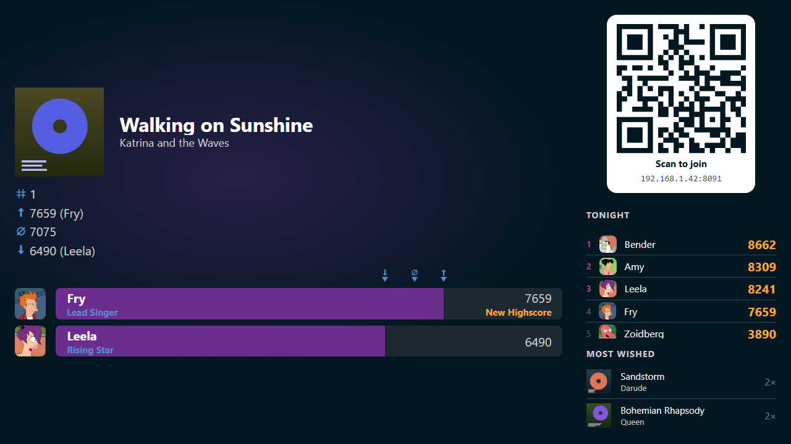
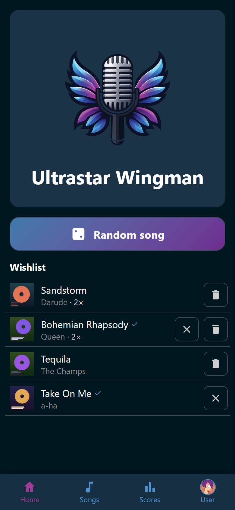
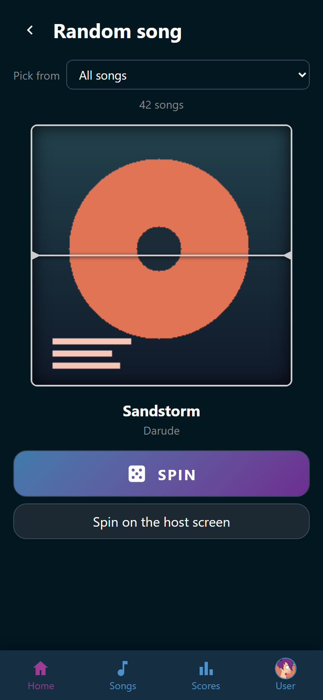
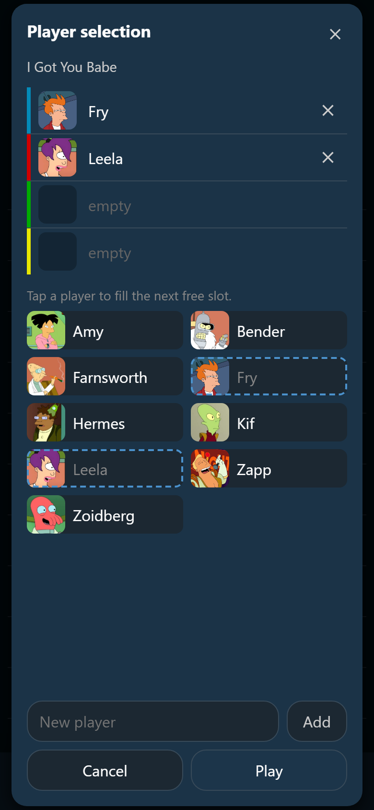
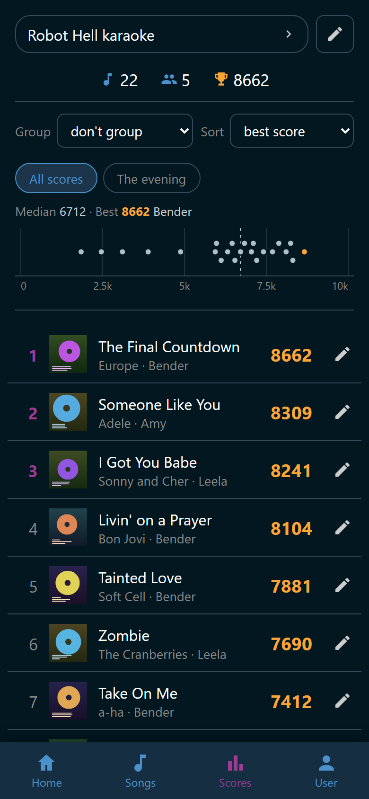

  

# Ultrastar Wingman

Karaoke companion for [Ultrastar Deluxe](https://usdx.eu), the free karaoke game
for PC. Guests scan the QR code on the TV, then search songs, add wishes, and
pick who sings, all on their own phone. Wingman starts the song in Ultrastar
Deluxe and keeps the scores. Nothing to install on a phone, no account needed.

**[Documentation](https://yannis4444.github.io/Ultrastar-Wingman/)** · **[Download](https://github.com/Yannis4444/Ultrastar-Wingman/releases)**

  
  
  
  

## What it does

- **Song list** on every phone: search, sort, filters, tags
- **Wishlist** for the whole room
- **Start a song** from a phone: pick singers and microphone colors, tap **Play**
- **Random song reel** on a phone or the TV: all songs, the wishlist, or a playlist
- **Scores** per party and per singer: charts, images to share
- **Achievements**: 35 badges included, create your own
- **Host screen** for the TV: QR code to join, standing, top wishes, results
- **Song downloads** from [USDB](https://usdb.animux.de), with your USDB account
- **Background music** from your library between songs, at an even loudness
- **Optional accounts**: favorites, playlists, groups, permissions, single sign-on
- **Player selector**: a DIY box with RFID cards that picks the singers
- **REST API** and WebSocket events for your own tools
- Free and open source

## Get it

Windows 10 and 11 (64-bit, x64), on the PC that runs Ultrastar Deluxe. Download
from the [releases](https://github.com/Yannis4444/Ultrastar-Wingman/releases).

| Download | What it is |
|---|---|
| `UltrastarWingman-<version>-with-usdx-setup.exe` | Wingman with Ultrastar Deluxe included. Take this one if unsure |
| `UltrastarWingman-<version>-setup.exe` | Wingman alone. Needs [this Ultrastar Deluxe build](https://github.com/Yannis4444/USDX): a stock one cannot start songs from Wingman |
| `UltrastarWingman.exe` | Portable, no install. Needs the same Ultrastar Deluxe build |

1. Run a setup. No administrator rights needed. It is unsigned: on **Windows
   protected your PC**, click **More info**, then **Run anyway**.
2. Start Wingman. The host screen opens in your browser. Phones on the same
   network join through its QR code.
3. Add your songs, and with Wingman alone, point it at Ultrastar Deluxe:
   [Get started](https://yannis4444.github.io/Ultrastar-Wingman/start/).

> [!NOTE]
> Wingman is in beta. Back up your data folder before you update, and report
> what breaks in the [issues](https://github.com/Yannis4444/Ultrastar-Wingman/issues).

Full guide: <https://yannis4444.github.io/Ultrastar-Wingman/>

## Develop it

Setup, commands, and checks: [`backend/README.md`](backend/README.md) and
[`frontend/README.md`](frontend/README.md). Building the exe and the installer,
and cutting a release: [`docs/dev/building.md`](docs/dev/building.md). How we
work (style, architecture, git, testing): [`CLAUDE.md`](CLAUDE.md) and
[`docs/dev/`](docs/dev/architecture.md).

## License

Wingman is free software under the [GNU General Public License v3](LICENSE).
The setup with Ultrastar Deluxe carries that program under its own license,
with a `SOURCE.txt` naming where its source is.
