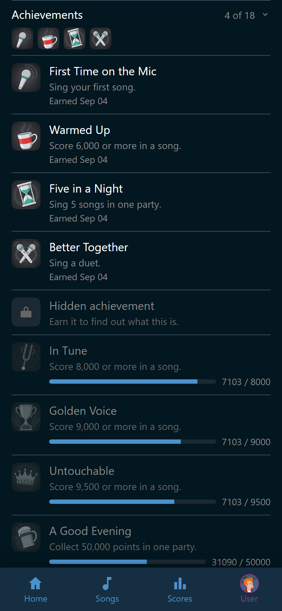
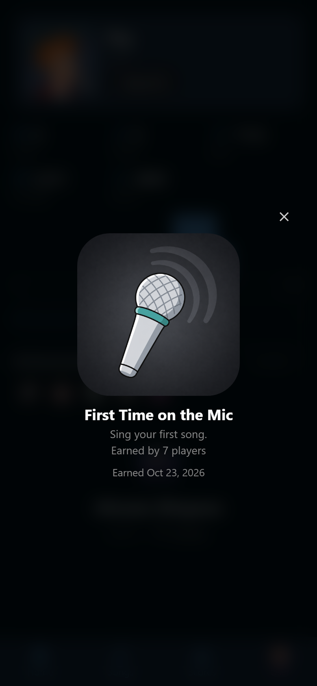
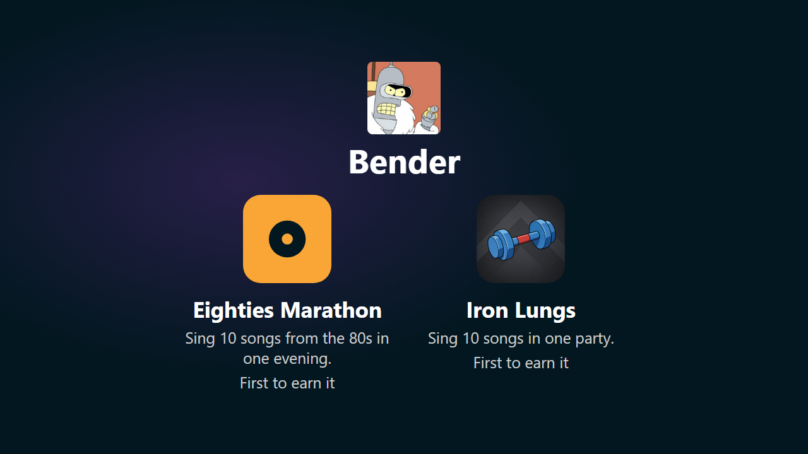

# Achievements

An achievement is something to reach for: sing your first song, break 9,000,
get through five songs in one night. Wingman works them out from the recorded
scores and hands out the badge.

Badges belong to players, not to accounts. A guest who sang tonight earns them
exactly like anybody else. A score Ultrastar Deluxe filed under a name that
matched no player earns nothing, because Wingman does not know who that was.

Everybody sees badges, and nobody needs a permission for that. Making them and
switching them off takes the right to manage achievements, which Admin holds by
default. See [Roles and permissions](../people/roles.md).

## Your badges on your own page

Log in and open **User**. Under your scores stands **Achievements** with your
badges beside it. The count says how many you hold out of how many there are.
Before your first one it says "Nothing yet. The first one is a song away".

Tap the line to fold out the whole list. The ones you earned come first, newest
first. The rest follow in the order the host arranged them in.

{ width="320" loading=lazy }
/// caption
The bar under **In Tune** says Fry has 7,103 of the 8,000 it asks for.
///

| A row | What it means |
|---|---|
| In color, with a date | Earned, on the day it says |
| In gray | Not yet. The description says what to do |
| A bar and a number, such as *7 / 10* | How far along you are |
| :wingman-lock: **Hidden achievement** | One the host is keeping back. Earn it and the row fills in |

Not every unearned row has a bar. An achievement asking for a score *below*
something, or for exactly a number, has nothing to fill up. A hidden one never
shows a bar either, because the bar would give the surprise away.

A bar for something that has to happen **in one evening** counts tonight, not
your best night ever. It fills up while the party runs, and between parties it
reads *0 / 10* with the bar empty: ten songs in one evening is ten songs again
next time. Bars for the all-time achievements keep counting up whatever night
it is.

The count is over the achievements that are switched on, so it doubles as the
list of what is left to reach for. The block stays away when the host switched
achievements off. It also stays away for an account with no player behind it,
and for a guest phone, which has no account at all. A guest still earns badges
and meets the new ones on the TV.

!!! note
    Badges are worked out again from your scores every time, never counted up
    as you go. If somebody moves a score to the right singer or deletes one,
    the badges follow. Earn one again and it is stamped with the new day.

## One badge, large

Tap a badge, on the strip or in a row, and it opens large over the blurred
page. You see the picture at the size it was drawn for, the name, the
description, and the same line the row carries. An earned one says the day.
One still out there shows its bar and its numbers, or nothing where there is
nothing to fill up. A hidden one opens as well, and says exactly what its row
says.

{ width="320" loading=lazy }
/// caption
Tap the darkened page above or below it, or :wingman-close: in the corner.
///

## The moment on the host screen

When a song is over, the host screen holds the results back and throws the new
badges up first. They take the whole screen: the QR code, **Tonight** and
**Most wished** are gone for those seconds, and come back the moment the badges
are done. One singer at a time: their picture and their name, and their badges
flying in beside the name and the one-line description. At most four badges
land in a row. Then the next singer, then the results as usual.

{ width="720" loading=lazy }
/// caption
The results of the song wait until the badges have had their moment.
///

A song where nobody earned anything goes straight to the results.

How long a row stays is up to the host, on the achievements page. It is a base
count of seconds plus a few more for each badge in the row, four and two out of
the box. See [Manage achievements](manage/index.md).

## What Wingman brings with it

Seventeen achievements ship with Wingman. A party may rename them, recolor
them, hide one, and switch any of them off. What they ask for is fixed, so
**Golden Voice** means the same thing at every party.

| Achievement | What earns it |
|---|---|
| **First Time on the Mic** | Sing your first song |
| **Warmed Up** | Score 6,000 or more in a song |
| **In Tune** | Score 8,000 or more in a song |
| **Golden Voice** | Score 9,000 or more in a song |
| **Untouchable** | Score 9,500 or more in a song |
| **A Good Evening** | Collect 50,000 points in one party |
| **Big Night** | Collect 100,000 points in one party |
| **Marathon** | Collect 250,000 points in one party |
| **Regular** | Sing 10 songs |
| **Resident** | Sing 50 songs |
| **Living Legend** | Sing 100 songs |
| **Five in a Night** | Sing 5 songs in one party |
| **Iron Lungs** | Sing 10 songs in one party |
| **Hat-trick** | Score 9,000 or more three times in one party |
| **Better Together** | Sing a duet |
| **Well Traveled** | Sing songs by 10 different artists |
| **Brave Soul** | Hidden until it is earned. Its own line is on **User** > **Achievements** |

"One party" means one evening of singing, the same party the **Scores** tab
lists. See [Scores](../scores/index.md).

## The pages in this section

- [Make an achievement](manage/create.md): the editor, the conditions, and a worked
  example.
- [Manage achievements](manage/index.md): the three options, the order of the list,
  the ones Wingman ships, and archives.
