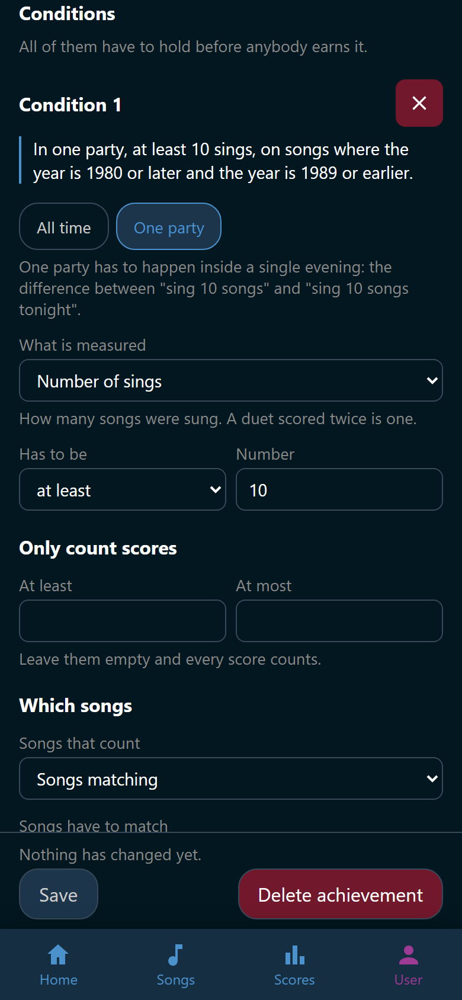

# Make an achievement

An achievement of your own is a badge plus the conditions that earn it. Making
one takes the right to manage achievements, which Admin holds by default.

## Fill in the form

1. Open **User** > **Achievements**.
2. Tap :wingman-plus: **New achievement**.
3. Type a **Name**.
4. Type a **Description**. That is the line a singer reads under the badge, so
   say what they have to do, not how it is measured.
5. Pick a glyph under **Icon**, or tap :wingman-close: **No icon**.
6. Pick one of the four colors under **Color**: **Neutral**, **Blue**,
   **Pink**, or **Gold**.
7. Decide **Hidden until earned** and **Enabled**.
8. Add the conditions, below.
9. Tap **Save**.

**Save** and the editor's other action sit in one row at the bottom of the
screen, wherever you have scrolled to.

**Hidden until earned** keeps the name, the description, and the glyph back
from everybody who has not earned it. They see a locked badge instead. Earning
one announces it to the party. **Enabled** off means the achievement is not
worked out and not drawn anywhere.

### Use a picture instead of a glyph

A picture needs an achievement to belong to, so save the new one first. Then
tap **Use a picture instead** and pick a jpeg, png, or webp file of at most
5 MB. The picture replaces the glyph, and **Color** has nothing left to set.
**Replace picture** swaps it, and **Use a glyph instead** drops it again.

The seventeen included achievements come with a picture each, drawn in one
style. To make a picture for your own achievement that matches them, see
[Make a badge picture](picture.md). An included achievement always has a
picture: upload your own to replace it, and **Back to the included picture**
brings Wingman's back.

## What a condition says

An achievement is a list of conditions, and all of them have to hold. Tap
**Add condition** and one block appears, numbered, with
:wingman-close: **Remove condition** at its corner. A fresh block reads
*"Over all time, some score of 9000 or more."*, so most achievements change two
or three boxes.

Under that number stands the sentence the block means. If the sentence says
what you meant, the condition does too.

{ width="320" loading=lazy }
/// caption
The block below builds the sentence at the top of it, box by box.
///

**All time** or **One party**. The first looks at everything the singer ever
did. The second has to come true inside a single evening. If several conditions
say **One party**, they all have to come true in the same one.

**What is measured**, over the scores that survive the two filters below.

| Measure | What it counts |
|---|---|
| **Any score** | One single score. With *at least* or *more than* that is the singer's best. With *at most* or *less than* it is their worst |
| **Sum of scores** | Every score added up |
| **Number of sings** | How many songs were sung, once per run. A duet scored twice is one |
| **Number of scores** | How many scores there are |
| **Different songs** | How many different songs |
| **Different artists** | How many different artists |
| **Average score** | The mean, rounded down. Nobody with no scores has one |

**Has to be** and the **Number** next to it: *at least*, *more than*,
*exactly*, *at most*, or *less than*.

**Only count scores** throws scores outside its range away before the measure
is worked out. That is how "ten scores above 9,000" is built: **Number of
scores**, *at least*, `10`, with **At least** set to `9000`. Leave both boxes
empty and every score counts.

## Which songs count

**Songs that count** narrows the scores further.

- **All songs** is no restriction.
- **Chosen songs** opens **Search songs**. Type a title or an artist and pick
  songs one by one.
- **Songs matching** tests what the song files say.

Under **Songs matching**, **Songs have to match** takes **All of them** or
**Any of them**. **Add song rule** adds one rule. A rule is a field, a test,
and a value, under its own number and its own
:wingman-close: **Remove song rule**.

| Field | Tests | Value |
|---|---|---|
| **Title**, **Artist**, **Genre**, **Language**, **Edition** | *contains*, *is*, *starts with*, *matches regex* | Text |
| **Year** | *is*, *at least*, *at most* | A number |
| **Duet**, **Video** | *is* | **Yes** or **No** |

*matches regex* is for the rule the other three cannot say, such as "either
Queen or ABBA". A pattern matches anywhere in the field and ignores case.
Wingman refuses one it cannot read, and one whose repetitions would take too
long to try.

A song whose file says nothing about a field never matches a rule about it. A
song that has left the library counts under **All songs**, because it was a
score somebody got. It counts for nothing under the other two, because the file
that said what it was is gone.

!!! example "Sing 10 songs from the 80s in one evening"
    1. Tap **Add condition**.
    2. Tap **One party** at the top of the block.
    3. Set **What is measured** to **Number of sings**. It counts songs sung,
       so singing one 80s song twice counts twice. **Different songs** would
       count it once.
    4. Leave **Has to be** on *at least* and type `10` in **Number**.
    5. Leave both boxes under **Only count scores** empty. Any score counts,
       however badly it went.
    6. Set **Songs that count** to **Songs matching**.
    7. Leave **Songs have to match** on **All of them**.
    8. Tap **Add song rule**. Set the field to **Year** first, because the
       tests on offer depend on the field. Then set the test to *at least* and
       the value to `1980`.
    9. Tap **Add song rule** again. Set the field to **Year**, then the test
       to *at most* and the value to `1989`.

    The sentence over the block now reads: *"In one party, at least 10 sings,
    on songs where the year is 1980 or later and the year is 1989 or earlier."*

    Give it a name such as `Eighties Marathon` and tap **Save**. The badge
    lands on the host screen the night somebody gets there.

## Why Save is gray

The line above **Save** says why it is off.

| The line | What to do |
|---|---|
| "It needs a name before it can be saved." | Type a name |
| "A condition above needs putting right before this can be saved." | Fix the condition that carries a message in red |
| "It did not go through. The message at the top of the page says why." | Read that message |
| "Nothing has changed yet." | Nothing. It is already saved |

An achievement with no conditions at all saves, and the form warns you. Nobody
can ever earn it.

## Change or delete one

Tap a row on **User** > **Achievements** to open it again. Everything about an
achievement your party made is editable. **Delete achievement**, beside
**Save**, removes it and everybody's badge for it. Their scores stay exactly as
they are.

The seventeen Wingman ships behave differently. See
[Manage achievements](index.md).
