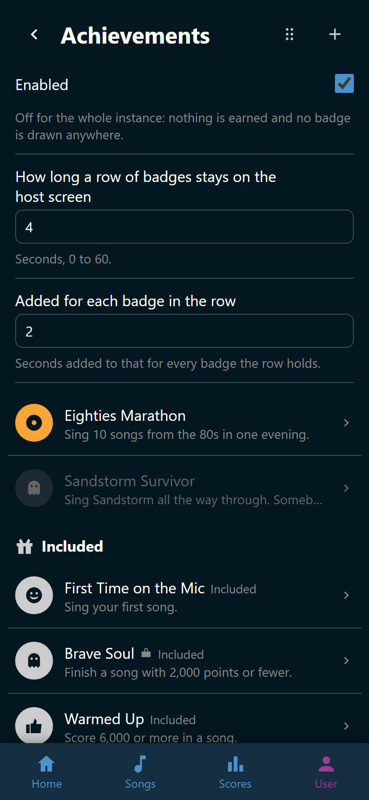

# Manage achievements

**User** > **Achievements** is where a party looks after its badges. It holds
the three options the feature has, the achievements somebody here made, and the
seventeen Wingman brings with it. It takes the right to manage achievements,
which Admin holds by default.

{ width="320" loading=lazy }
/// caption
**Sandstorm Survivor** is drawn in gray, so nothing is being earned on it.
///

## The three options

They sit at the top of the page and save as you set them. They are not on the
**Settings** page, because they belong to whoever looks after the badges rather
than to whoever configures Wingman.

| Option | What it does | Default |
|---|---|---|
| **Enabled** | Achievements for the whole app. Off means nobody earns anything and no badge is drawn | On |
| **How long a row of badges stays on the host screen** | Seconds, 0 to 60 | 4 |
| **Added for each badge in the row** | Seconds added to that for every badge the row holds | 2 |

So a row of three badges stands for ten seconds out of the box. Switching the
feature back on brings everybody's badges up to date.

## The two lists

The achievements your party made come first. Under :wingman-gift: **Included**
stand the seventeen Wingman ships. A row shows the badge, the name, and the
description a singer reads under it. Tap a row to open the editor. See
[Make an achievement](create.md).

Beyond that a row only says what is unusual about it.

- :wingman-lock: after the name means the achievement is hidden until it is
  earned.
- *Included* after the name means Wingman brings it with it.
- The whole row in gray means it is switched off. Nothing is being earned on
  it.

## Arrange the order

1. Tap :wingman-drag-handle: **Arrange the order** in the page header.
2. Drag a row by its grip, or tap :wingman-arrow-up: and
   :wingman-arrow-down: to move it one place.
3. Tap the same button again when you are done.

Every move is saved as you make it. The two lists are arranged separately, and
your own always come first.

This order is what the host screen follows and what a singer's own page falls
back on. On a singer's page the badges they earned come first, newest first,
and the rest keep the order you set.

If somebody adds, imports, or deletes an achievement while you are arranging,
Wingman says "The achievements changed somewhere else, so this order no longer
fits". The rows go back the way they are saved, and you can arrange them again.

## The ones Wingman ships

An included achievement can be renamed, recolored, hidden, and switched off
like any other. Two things are not yours to change.

- What it asks for. Its conditions are drawn locked, so **Golden Voice** means
  the same thing at every party.
- It cannot be deleted.

Where **Delete achievement** would be, an included one has :wingman-refresh:
**Reset achievement**. It asks first. Then it puts the name, the description,
the color, the conditions, and whether it is hidden back the way Wingman ships
them. A picture you uploaded is dropped, and the badge Wingman brings with it
is drawn again.

Two things a reset leaves alone: whether the achievement is switched on, and
where it sits in the list. Switching one off is meant to stick, and the order
is yours.

!!! warning
    Everybody's badges are worked out again after a reset. If you had made an
    achievement easier than Wingman ships it, resetting it takes that badge
    away from whoever only met the easier version.

## Carry achievements to another party

At the foot of the page stands :wingman-archive: **Import and export**. An
archive is one `.tar.gz` file with a folder per achievement, holding its
settings, its conditions, and its picture. It is a plain file, so a set you
invented on one machine can be handed to another or published.

**To export:** tap :wingman-download: **Export**, select the achievements you
want, and tap **Export · N**. **Select all** picks every row, included ones
among them, and **Select none** clears them again. The file lands in your
downloads under a name with today's date.

**To import:** tap :wingman-upload: **Import archive** and pick the file.
Wingman says in words what happened, such as "Added Golden Voice and updated 14
achievements".

Import matches by the achievement's id, which is the folder name in the
archive.

- An achievement this Wingman already has is updated, and it takes the place in
  the list the archive gives it.
- One of the included seventeen is updated too, but its conditions are left
  alone.
- One this Wingman does not have is added.

Importing the same archive twice is not a way to get two copies. It is a way to
put things back the way the archive has them.

!!! warning
    An entry with no picture in it clears the uploaded picture of the
    achievement it updates. The archive is the whole description of what it
    names. An included achievement goes back to the badge Wingman brings with
    it, which an archive never carries because every Wingman has it.

Nothing is written until the whole archive has been read and every picture
checked, so a broken file changes nothing at all. Wingman names which
achievement was wrong and what about it, which is usually one keystroke from a
fix. An archive may be at most 32 MB.

Exporting takes the same right as making an achievement, although it only
reads. An archive carries what every achievement asks for, and the real names
of the hidden ones.

## Every change re-checks everybody

Creating, editing, resetting, importing, and switching one on all send Wingman
back over everybody who ever sang. An achievement that is already true of what
somebody sang months ago is earned the moment you save it. It takes a moment,
so give the page a second before you go looking for the badge.
