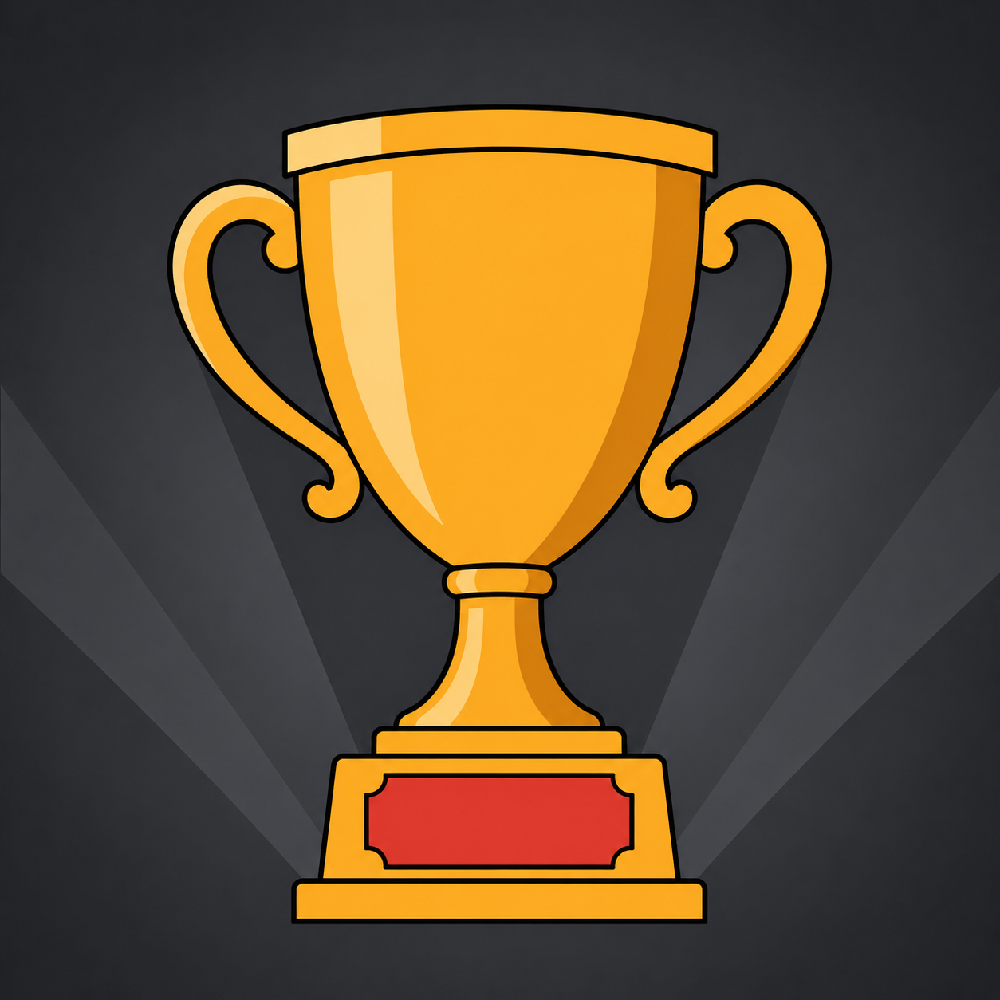

# Make a badge picture

The seventeen included achievements each carry a picture drawn in one style: a
dark gray square with one bold object on it, colored by the achievement's
color. This page is how to make a picture in that style for an achievement of
your own, with an image generator such as ChatGPT. It takes about five minutes
per badge.

{ width="320" loading=lazy }
/// caption
The reference badge. Save this file. Every picture you make is generated
alongside it.
///

## What a badge looks like

Every badge follows the same rules, and the prompt below spells them out for
the generator. Knowing them helps you judge a result.

- **A square, filled edge to edge.** A dark gray plate with a soft lighter
  spot behind the object. No frame, no border, no circle. Wingman rounds the
  corners when it draws the badge.
- **One object, big.** It fills about four fifths of the square and stands
  alone. No scene, no second object, no text.
- **The achievement's color on the object.** Neutral is silver, blue is blue,
  gold is gold, pink is pink. The object is drawn in three tones of that color,
  like a flat enamel pin with dark outlines.
- **One small accent.** One extra color on one small part of the object: the
  red plaque on the trophy, the cream ball on the tuning fork. It comes from a
  set of four so the badges stay a family.
- **A little life.** The object is tilted or in motion, with at most one
  action cue that is part of its shape: steam off a mug, exhaust under a
  rocket. No sparkles, no speed lines.
- **One faint gray shape behind it.** Something that fits the object, in gray
  only: sound waves behind a microphone, rings behind a tuning fork. It all but
  disappears when the badge is small.

The badge is drawn at 40 pixels in most lists. Anything you cannot make out at
that size is not worth drawing.

## Write the three lines

Decide the object, its accent, and its background before you prompt. Each is
one sentence in a fixed shape.

| Line | Shape | Golden Voice |
|---|---|---|
| MOTIF | a single *object*, its pose, its one action cue | a single trophy cup with two curved handles, a short stem and a flat base, seen from slightly below so it looms, standing upright; no action cue. |
| ACCENT | one of red, teal, cream, or pink, and where it goes | red #d9534f, on the plaque on the front of the base |
| BACKGROUND | one large gray shape that fits the object | three wide stage-light beams fanning up from behind the base. |

Pick the accent so it stands apart from the achievement's color: no teal on a
blue badge, no cream on a neutral one. Avoid faces and hands. Generators draw
them differently every time.

!!! example "A badge for Sing 10 songs from the 80s in one evening"
    The achievement is blue. A cassette tape is the 80s in one object.

    - MOTIF: a single cassette tape seen straight on, tilted 15 degrees to the
      right, with one loop of tape spilling out of its lower edge.
    - ACCENT: red #d9534f, on the label across the top of the cassette.
    - BACKGROUND: two wide horizontal bands sweeping behind the cassette.

## Generate the picture

1. Open ChatGPT and start a new chat.
2. Attach the reference badge from the top of this page.
3. Paste the prompt below. Put the achievement's color line in place of
   `{TIER LINE}`, and your three lines in place of `{MOTIF LINE}`,
   `{ACCENT LINE}`, and `{BACKGROUND LINE}`.
4. Ask for a square 1024 by 1024 image.
5. Check the result against the list in [Check the result](#check-the-result).
   Fix one thing per reply, and end each reply with "everything else
   identical".
6. Download the image. Do not screenshot it, and do not paste it through
   another program. Both change the file.

The color lines:

```
NEUTRAL: motif base #d6dde3, highlight #ffffff, shadow #8c98a4.
BLUE:    motif base #4b92cd, highlight #9cc9ef, shadow #2b5f8e.
GOLD:    motif base #faa636, highlight #ffd88a, shadow #b8701a.
PINK:    motif base #c85bbd, highlight #e99ae0, shadow #7a2c73.
```

The accent colors:

```
red #d9534f   teal #3fb8a8   cream #f3ead6   pink #c85bbd
```

The prompt:

```
Match the attached badge exactly: same layout, motif size and margin, plate grays and falloff, background subtlety, outline weight, shading style and color tones. Change only the motif, its accent and its background element as stated, and the tier colors. Do not reuse any part of the trophy itself: no base, no plaque.

Create a square 1024×1024 achievement badge illustration in a flat vector enamel-pin style. Follow every instruction literally.

LAYOUT (exact): The whole canvas is a square plate, edge to edge, with sharp square corners: no rounded corners, no frame, no border, no medallion, no circle, no background around it. The plate is a monochrome dark gray with one soft radial falloff: #3a3e43 at the center behind the motif, darkening smoothly to #1e2124 in the four corners, no banding, no hue. On the plate, exactly one motif, centered and dominant, filling about 84 % of the canvas width or height, whichever it is bigger in, with the same empty plate margin of about 8 % on all sides. Behind the motif, one large background element (see BACKGROUND). Nothing else on the canvas.

STYLE (exact): Flat vector illustration, like a hard enamel pin. Clean geometric shapes, smooth curves, crisp edges. Cel shading with exactly three tones on the motif: a base tone that covers most of it, one lighter highlight tone on surfaces facing up-left, one darker shadow tone on surfaces facing down-right. Every shape of the motif is separated by a uniform outline of #131517, about 1 % of the canvas width thick. Light comes from the top left. The motif is flat color fields only; the only gradient in the picture is the plate's radial falloff. The motif has life: it is posed with a slight tilt or already in motion, as the MOTIF line says, and carries at most one action cue that is part of its own shape.

COLORS (exact, no hue anywhere except the tier tones and the one accent): {TIER LINE}
The three tier tones cover at least four fifths of the motif. ACCENT: {ACCENT LINE}, the only other color in the picture, on the motif only, at most a fifth of it.
Plate gray #3a3e43 falling off to #1e2124. Outlines #131517. Background element grays #3f4349 and #2a2e33.

MOTIF: {MOTIF LINE} Draw it as one bold silhouette that would still be recognizable as a black-and-white cut-out at 40 pixels.

BACKGROUND: {BACKGROUND LINE} It is drawn only in the two flat background grays #3f4349 and #2a2e33, with no outline, laid over the plate's falloff. Large simple forms only, nothing smaller than a tenth of the canvas, nothing repeated. It stays entirely behind the motif and never touches or crosses the motif's outline. It must be so subtle that it almost disappears when the picture is shrunk to 40 pixels.

FORBIDDEN: no text, letters, numbers, logos or signature; no scenery, no second object; no sparkles, stars, glows, rays, drop shadows or reflections; no speed lines, particles, drops or multiple motion strokes; no gradients on the motif; no textures, noise, grain, paper or brush strokes; no color on the background element; no 3D rendering or photorealism; no transparency; no faces or hands unless the MOTIF line names one.
```

## Check the result

Look at the picture small first. Shrink it to the size of a fingernail, or
step back from the screen.

- The object is recognizable at a glance, and the gray shape behind it has all
  but disappeared.
- The plate reaches all four edges. No frame, no border, no circle. A picture
  with a border is a new attempt, not a crop.
- The object keeps an empty margin on every side and touches no edge.
- The only colors are the three tones of the achievement's color and the one
  accent, where you put it.
- No text, no sparkles, no glow, no extra objects. Generators add these
  unasked. "Remove the sparkles, everything else identical" takes them away.

!!! note
    The generator borrows from the reference. If your badge comes back standing
    on the trophy's pedestal with its red plaque, reply "remove the base and
    the plaque, the object stands on its own, everything else identical".

## Put it on the achievement

1. Open **User** > **Achievements** and tap the achievement.
2. Under **Icon**, tap **Use a picture instead** and pick the downloaded file.
   On an included achievement the button is **Replace picture**.
3. The badge in the editor shows the new picture at once. Nothing else to save.

The file is a png of about 1 MB, well under the 5 MB limit. Wingman draws it
at 40 pixels in the lists and larger on the host screen. Keep the downloaded
file: a picture that is lost cannot be generated again in exactly the same
way.
