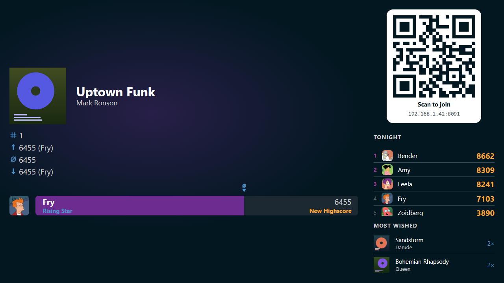
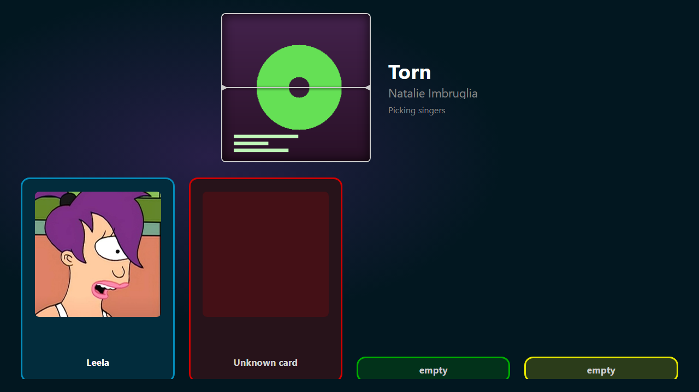
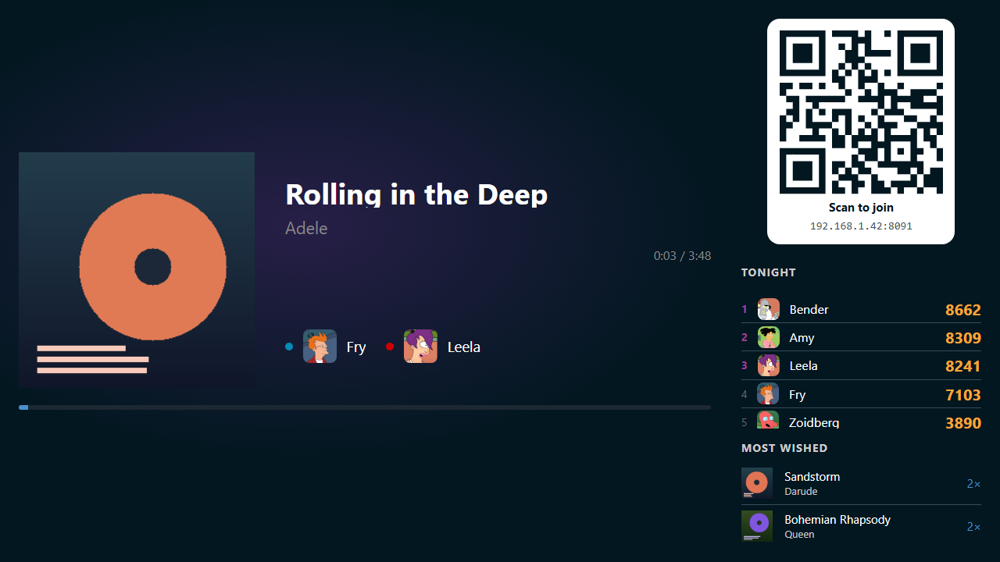

# The host screen

The host screen is the Wingman page on the TV, next to Ultrastar Deluxe. It is
how the room gets in, and it is the scoreboard between songs. Wingman opens it
on the karaoke PC by itself when it starts.

The browser that opened it holds host rights. Those rights are not an account.
They may change every setting and stop a running song, and they own no
favorites and no playlists.

## Put it on the TV

1. Start Wingman on the karaoke PC. See
   [Install and run](../start/install.md).
2. Let it open your browser. The page it opens is the host screen.
3. Put that browser window on the TV, in full screen.

The link Wingman opens carries a one-time token, and trading it for host rights
is what makes that browser the host. The same link stands in the console
window, on the line with `Host UI:`. Copy it into a browser when none opened,
or when the wrong one did. Set `WINGMAN_OPEN_BROWSER` to `false` to stop
Wingman opening a browser at all.

!!! warning
    The host link works once. Wingman prints a new one every time it starts. A
    page saying the link does not work any more means you need that new line
    from the console. Browsers that already hold host rights keep them.

The corner of the screen says *This browser holds host rights* while they are
in force. See [People](../people/index.md) for what that browser may do.

## What stands where

The screen has two columns. The left one is the stage, and it always shows what
the party is doing right now. The right one is the rail, and it is how to take
part.

{ width="720" loading=lazy }
/// caption
The rail stays up for most of what the stage shows. New badges take the whole
screen.
///

The rail holds three blocks, top to bottom:

- The QR code, under **Scan to join**, with the same address written out below
  it. See [Let guests in](../start/join.md).
- **Tonight**, the standing of the party so far.
- **Most wished**, what the room has asked for.

**Tonight** appears once two songs of this party have been scored, and it lists
the five strongest singers. The three words beside the heading say how they are
ranked: **best score**, **average**, or **sings**. Click one to change it. The
first three places carry a highlighted rank number.

**Most wished** is the wishlist, most wished song first, with the number of
wishes beside each. It holds five songs on its own, and three while **Tonight**
is up. See [Wish for a song](../party/wishlist.md).

## While singers are picked

When somebody taps **Sing** on a phone, or puts a card on the player selector,
the room is picking singers. The stage takes the whole screen for it, and the
rail is down until the song starts or the pick is given up. The song stands at
the top over the line *Picking singers*. Along the foot stands one card per
microphone slot, filling up as singers are picked. See
[Sing a song](../party/sing.md) and [Player selector](../selector/index.md).

When a phone spins the reel on the host screen, the reel stands where the cover
would. The line reads *Spinning…* while the covers scroll past. The title and
the artist appear when the reel lands, and every **Spin again** runs it once
more. No countdown runs on a spun song. Whoever spun it presses **Play**. See
[Let the reel pick](../party/reel.md).

{ width="720" loading=lazy }
/// caption
The reel has landed. Two of the slots are held by cards on the player selector.
///

## While a song plays

The stage shows the cover, the title, and the artist. Under them stand the time
played against the song's length, a progress bar, and every singer on the color
of their microphone. The rail carries on beside it, so the QR code and the
standing stay up the whole time.

{ width="720" loading=lazy }
/// caption
Fry sings on blue and Leela on red, the colors they were given.
///

## When a song ends

Wingman reads the scores and the stage turns into the result screen for the
song that finished:

- its cover, title, and artist,
- **Sings**, **Best**, **Average**, and **Worst** over the whole life of that
  song, beside the cover and under the artist, with the name of whoever holds
  the best and the worst,
- one bar per singer of this run, with their name, their evaluation, and their
  number, best singer first.

A singer who beat the song's own record gets **New Highscore** next to their
score. The three all-time numbers are marked on the same scale as the bars, so
you can see at a glance where tonight's run landed. Marks that would sit on top
of each other are left out: a song everybody scores about the same on keeps one
mark for the average, and the numbers themselves are printed above in full
either way.

Badges come before all of that. If the song earned somebody an achievement, the
stage holds the results back and throws the badges up first, over the whole
screen. They come one singer at a time, four badges to a row. How long a row
stays is set on **User** > **Achievements**. See
[Manage achievements](../achievements/manage/index.md).

## While nothing plays

The result screen stands there until the next song starts, so a host screen
opened cold shows the last song anybody scored. That can be a song from an
earlier party.

The stage carries the Wingman logo, its name, and the line *Scan the code to
pick a song* in two cases. One is a Wingman that has never scored a song. The
other is a song that was started and scored nothing, which is what a stopped
song leaves behind.

## The controls that fade

The corner controls are only for whoever is at the karaoke PC. They fade out
after a few seconds without a mouse or a keyboard, and come back on the next
movement. So do the three ranking words beside **Tonight**.

- :wingman-gear: **Manage** opens the management page. See
  [Manage from the TV](manage.md).
- :wingman-stop: **Stop** ends the song. It asks first, and it names the song.
  It is there while a song plays, for a browser that may stop one.
- The line saying this browser holds host rights.

!!! warning
    A song that is stopped scores nothing. Ultrastar Deluxe writes a score only
    for a song sung to the end.
