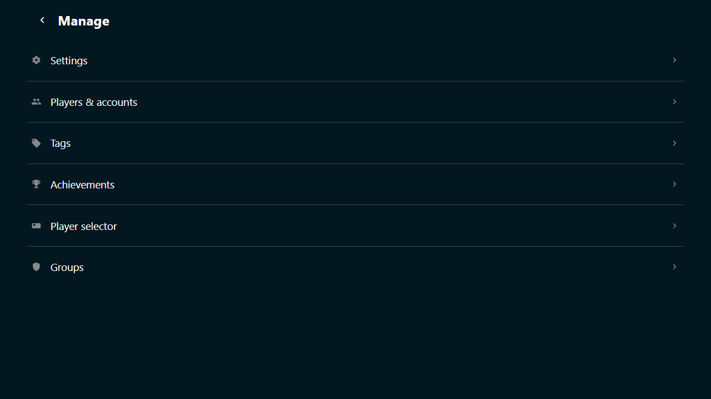

# Manage from the TV

**Manage** is the way from the host screen into everything the host sets up. It
exists because the host screen sits on a TV across the room, where the
phone-shaped user page would only get in the way.

## Open it

Move the mouse to bring the corner controls back, then click :wingman-gear:
**Manage**. :wingman-chevron-left: **Back** at the top left returns to the host
screen. So does every page you open from here, which is the whole point of this
view.

{ width="720" loading=lazy }
/// caption
The host browser holds every right, so it gets all six rows.
///

## The rows

- :wingman-gear: **Settings**: everything Wingman is configured with, from the
  Ultrastar Deluxe paths to the singing slots and their colors. See
  [Settings](../settings/index.md).
- :wingman-users: **Players & accounts**: the people at the party, their
  pictures, their groups, and who the singer picker offers. See
  [Players and avatars](../people/players.md).
- :wingman-tag: **Tags**: the labels on songs, who may see them, and the
  built-in marks and facets. See [Tags](../tags/index.md).
- :wingman-trophy: **Achievements**: the badges this party hands out, and the
  three options behind them. See
  [Manage achievements](../achievements/manage/index.md).
- :wingman-card: **Player selector**: the box of card readers that picks the
  singers, and the cards that go with it. See
  [Player selector](../selector/index.md).
- :wingman-shield: **Groups**: the groups of the party and what each one may
  do. See [Groups and permissions](../people/groups.md).

A row is only there when this browser may do something behind it. The host
browser holds every right, so it sees all six.

## When there are no rows

A browser that never traded the host link for host rights gets one sentence
instead of the rows: *This browser has no management rights. Open the host link
from the server log to run the party from this screen.* The link is in the
console window, on the line with `Host UI:`. See
[The host screen](index.md).

## The pages behind the rows

Nothing behind these rows is special to the TV. They are the same pages a phone
reaches under **Manage** on the **User** tab. Only the way back changes.
