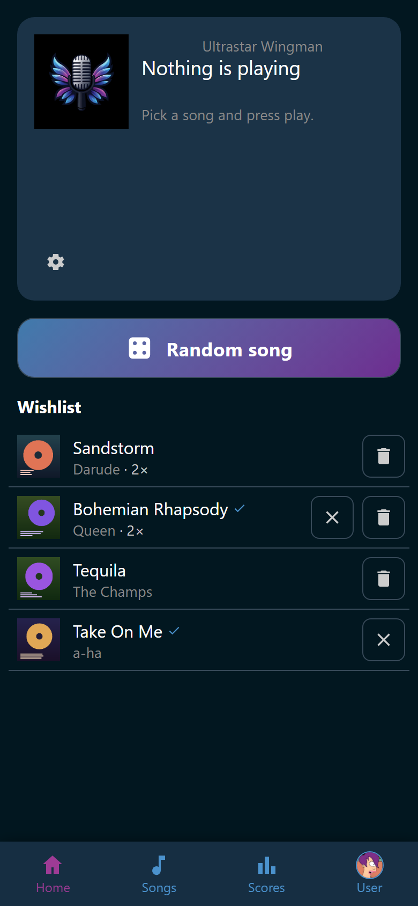

# At the party

**Home** is the page everybody lands on. It shows what is playing right now, the
wishlist for tonight, and the way into the random reel. Guests need no account
for any of it. They scan the QR code on the host screen, open Wingman on their
own phone, and join in.

{ width="320" loading=lazy }
/// caption
Nothing is playing, so the player at the top carries the Wingman logo.
///

This section is the evening itself. It covers what the room wants to sing, how a
song gets started, and how one gets picked when nobody can decide.

- [Wish for a song](wishlist.md): put a song on tonight's list, read the list,
  and take a wish back.
- [Sing a song](sing.md): pick the singers and their microphone colors, start
  the song, and see what Wingman does when it ends.
- [Let the reel pick](reel.md): the random song picker, and what it picks from.

A song's own view is where both of those start. Tap
:wingman-playlist-plus: **Wish** and the whole room sees the song on the
wishlist. Tap :wingman-heart: **Add to favorites** and the song is yours alone,
party after party. A favorite carries its heart on the song's row in
[the song list](../songs/index.md). A wish does not. A wish belongs to tonight,
and the wishlist is where it is counted.

!!! note
    Six hours without a song ends the party. The next song starts a new party,
    with scores of its own.
