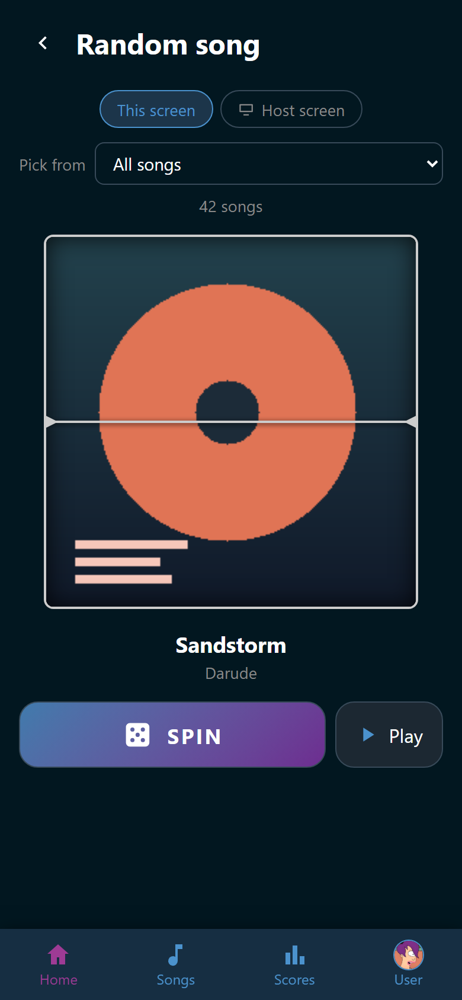
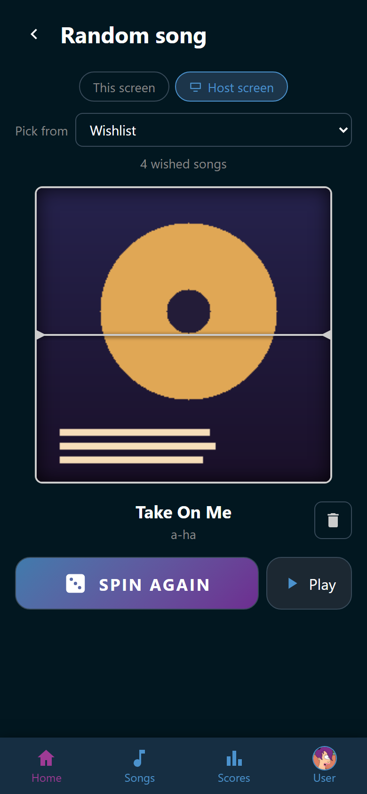
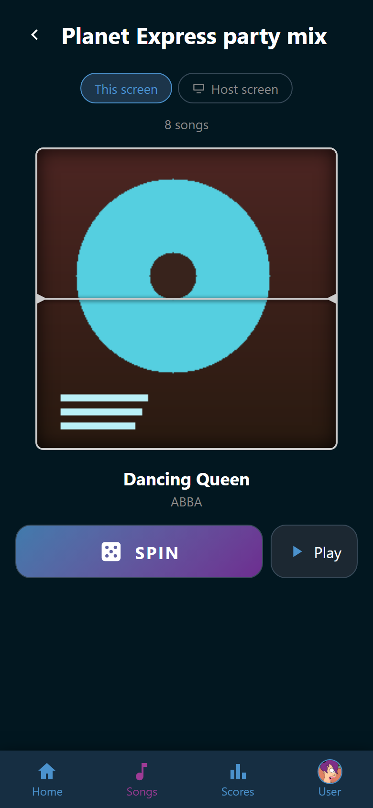

# Let the reel pick

Nobody can decide what to sing? The reel picks for you. A stack of covers
scrolls past for a few seconds and stops on the winner.

{ width="320" loading=lazy }
/// caption
The line under **Pick from** counts the songs in the running.
///

There are two ways in:

- **Random song** on **Home** opens the reel over the library.
- :wingman-dice: **Random song from this playlist** at the top of a playlist
  spins that playlist alone. See [Playlists](../songs/playlists.md).

## Spin it

1. Choose what the reel may pick from in the **Pick from** list. The line under
   it says how many songs are in the running.
2. Tap **Spin**.
3. The reel runs for a few seconds and reveals the song.
4. Tap the winner to open it. From there you go straight into
   :wingman-play: **Sing**. Or tap :wingman-play: **Play** beside **Spin** to
   pick the singers for it right away. See [Sing a song](sing.md).

**Play** is there for anybody who may start a song. It stays off until the reel
has landed.

## What it picks from

| Choice | What can win |
|---|---|
| **All songs** | Every song in the library, minus what a tag folds away |
| **Favorites** | Only the songs you gave a heart |
| **Wishlist** | Only wished songs, each with the same chance |
| **Wishlist (weighted)** | Only wished songs, more wishes mean a better chance |

Weighted is the fair one for a full room. A song three people wished for has
three times the chance of a song only one person wished for. Its line counts
both numbers: the wished songs, and the wishes behind them. See
[Wish for a song](wishlist.md).

A choice with nothing behind it cannot be picked. That is both wishlist choices
while nobody has wished for anything, and **Favorites** while you have hearted
nothing or are not logged in at all.

**All songs** leaves out the songs a tag folds away, the same songs the song
list keeps back until you ask for them. There is no filter up here to ask with.
The other three spin what people picked out by hand, a folded-away song
included. Somebody hearted it or asked for it on purpose. A song hidden from you
altogether can win in none of the four. See
[Songs you do not see](../songs/index.md#songs-you-do-not-see).

## Take the song off the wishlist

Spun one of the two wishlist choices and the room will not sing what came up?
The party's helpers get :wingman-trash: **Take off the wishlist for
everybody** right beside the winner's title once the reel lands on a wished
song. It takes the song off the wishlist for everybody, with no question in
between. The winner stays on screen, and the line under **Pick from** counts
one song fewer. Trusted and Admin hold that by default, the same as the button
on the wishlist itself. See [Wish for a song](wishlist.md#take-a-wish-back).

The button is not there on a playlist's reel or on **All songs** and
**Favorites**. It also stands beside the title when the reel spins on the TV.
See [Spin on the host screen](#spin-on-the-host-screen).

## Spin on the host screen

The reel can run on the TV instead, so the whole room watches the pick. Two
buttons at the top of the page say where it runs: **This screen** and
:wingman-tv: **Host screen**. They are there for anybody who may start a song.
Your phone remembers the choice for next time.

1. Tap :wingman-tv: **Host screen**. The TV does nothing yet.
2. Choose what the reel may pick from in the **Pick from** list.
3. Tap **Spin**. The covers scroll past on the TV. Your phone keeps the reel's
   empty frame and reads *Spinning on the host screen…*
4. The cover, the title, and the artist appear on your phone the moment the
   reel lands on the TV. To see the result sooner, tap **Show it**: the TV
   stops at once.
5. Tap **Spin again** for another song.
6. Tap **Play** to pick the singers: the player selection opens for that
   song. See [Sing a song](sing.md).

To stop, tap **This screen**. That gives the TV back and picks nothing. Leaving
the page does the same. There is no other button to close it.

Changed the **Pick from** list while the TV shows a song? The TV keeps that
song until you tap **Spin again**. Then it spins over the new choice.

On a wishlist choice, the party's helpers find :wingman-trash: **Take off the
wishlist for everybody** beside the title here as well, once the TV's reel has
landed on a song still wished for. The song comes off the wishlist and stays on
the phone. **Play** still picks the singers for it, and **Spin again** picks
another song.

{ width="320" loading=lazy }
/// caption
The same page, with the TV's pick under its cover. The animation is the TV's.
///

Wingman picks the song here, by the table above and as you see the library. A
song hidden from you cannot win on the TV either. A choice with nothing behind
it gets a sentence where the song would be, such as *The wishlist is empty. The
reel has nothing to land on.*

When the reel lands, the TV plays the song from where its singing starts, so the
room hears what it picked. It keeps playing after you tap **Play** while the
singers are picked, and **Spin again** starts the next song in its place. The
background music, if any, fades out for it and comes back afterwards. **Song
preview** under **Sound** in **Settings** switches this off, and **Preview
volume** beside it sets how loud it plays (see
[Background music](music.md#the-song-being-picked)).

Spinning on the host screen holds the room the way **Sing** does. Nobody else
can start a song while your phone holds the pick. If somebody is already
picking singers, the phone says so and offers **Take over** in place of
**Play**. Taking over ends their pick. When somebody takes over yours, your
phone reads *Somebody else took over the selection.* Tap **Spin** to start a
new pick.

On the TV, the reel stands where the song's cover stands while singers are
picked. It shows the reel and the song alone, and the microphone slots appear
once you tap **Play**. If cards on a player selector already fill every slot,
and the selector starts songs on its own, the countdown starts at that moment.
See [The host screen](../host-screen/index.md). The start button of a
[player selector](../selector/index.md) spins the same reel, with the slots
along the foot from the start.

## One playlist's reel

Opened from a playlist, the reel picks from that playlist and nothing else.
There is no **Pick from** list above it, only the number of songs it can land
on, and the playlist's name stands in the header.

{ width="320" loading=lazy }
/// caption
The header names the playlist, so the reel picks from its eight songs alone.
///

The dice appears once the playlist has a song in it. A song only folded away by
a tag can win here, the same way the playlist itself still lists it. Somebody
put it there on purpose. :wingman-tv: **Host screen** is here too, and spins
this playlist on the TV. A playlist's reel never takes a song off the wishlist.

!!! note
    A phone set to reduce motion skips the animation and shows the winner right
    away. The pick is the same either way.
