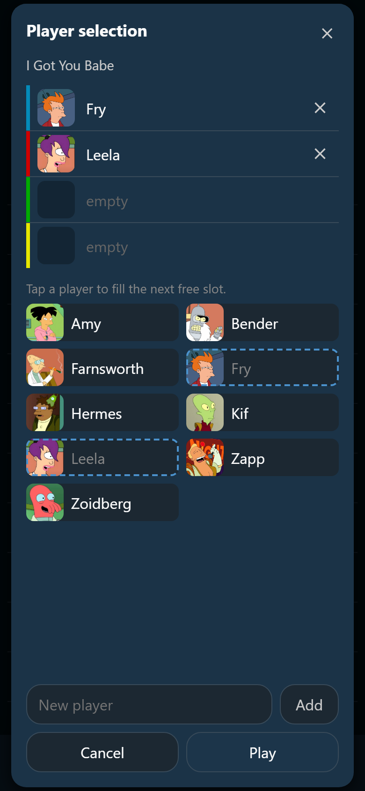
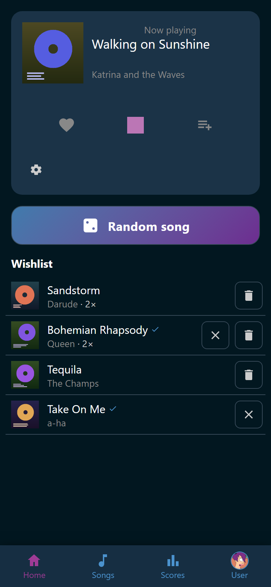

# Sing a song

Starting a song takes two steps: pick the song, then say who sings it. Ultrastar
Deluxe does the rest. Anybody in the room can do this, account or not.

## Start the song

1. Open the song. See [Open a song](../songs/song.md).
2. Tap :wingman-play: **Sing**. The player selection opens, with the song's
   title above it.
3. Tap a player to put them on the next free slot. Tap them again to take them
   off.
4. To fill one particular slot, tap that slot first, then tap the player. The
   line above the roster always says what the next tap does.
5. Tap **Play**.

At least one slot needs a player, so **Play** stays off until somebody stands on
one.

Ultrastar Deluxe opens on the TV with that song, and with the chosen names,
colors, and pictures already set up. The song leaves the wishlist at the same
moment. See [Wish for a song](wishlist.md).

## Slots and microphone colors

The rows at the top are the microphone slots, in the order Ultrastar Deluxe uses
them. Each carries its color as a bar down its left edge. Out of the box there
are four: blue, red, green, and yellow. The host sets how many slots there are
and which colors they use, in the **Karaoke** group of the settings. See
[Settings](../settings/index.md).

{ width="320" loading=lazy }
/// caption
The bar down the left edge of a slot is its microphone color.
///

The roster below the slots holds everybody Wingman knows, with an account or
without one. A guest sings under the name somebody typed for them.

- :wingman-close: **Clear slot** takes the person on a slot back off it.
- A slot a card holds carries the :wingman-card: card mark and no clear button.
  Tapping it answers *That slot is held by a card on the player selector.* Lift
  the card off the reader to free the slot.
- With more than twelve players, a **Filter players** box appears above the
  roster. Type any part of a name and only the matching people stay visible.
  Filtering only hides rows. Nobody loses a slot by being filtered away.
- Missing somebody? Type a name into **New player** and tap **Add**. The new
  player goes straight onto a slot. That takes the right to manage players,
  which Trusted and Admin hold by default.

Somebody the host hid for the evening is not in this list, and a slot you set
earlier does not bring them back. See
[Players and avatars](../people/players.md).

!!! note
    Your slot assignment is remembered in your browser. The same group does not
    have to pick again for every song. One exception: while a
    [player selector device](../selector/index.md) is connected, the slots start
    empty, and the picker says so under them: *A player selector is connected.
    The cards decide who sings. You can still change it here.*

## While the song plays

The player at the top of **Home** shows the running song: the cover, the title,
the artist, and the buttons under them. The elapsed time and the singers are not
repeated there, because the Ultrastar Deluxe screen in the same room already
shows both.

{ width="320" loading=lazy }
/// caption
The wishlist stays below the stage, so the room can keep reading it.
///

- :wingman-heart: **Add to favorites** and :wingman-playlist-plus: **Wish** do
  the same as in the song's own view.
- :wingman-stop: **Stop** is the large button in the middle. It asks before it
  ends the song. Only somebody who may stop a song sees it at all, which an
  account holds by default and a guest phone does not.
- Tap the cover to open the song's view without leaving the page.

The host screen shows the whole picture instead: the cover, the time, a progress
bar, and who is on which color. See
[The host screen](../host-screen/index.md).

!!! warning
    An unfinished song scores nothing. Ultrastar Deluxe writes a score only when
    a song is sung to the end, so a stopped song leaves no result behind.

## When the song ends

Wingman notices that Ultrastar Deluxe closed and reads the scores it wrote. Each
score is filed under the player Wingman put on that slot, so nobody has to type
a name.

1. The scores appear on the **Scores** tab. See [Scores](../scores/index.md).
2. Wingman works out what those scores earned and hands out any new badges. See
   [Achievements](../achievements/index.md).
3. The host screen holds the results back for a moment and throws the new badges
   up first, one singer at a time. A song where nobody earned anything goes
   straight to the results.

A score Ultrastar Deluxe filed under a name that matches no slot keeps the name
and belongs to no player. Nobody earns anything from it.

## Another song is playing

Starting a song while one is running offers to replace it. **Replace** stops the
running song first, so it takes the right to stop a song. Anybody else is told
to ask the host instead.

## Ultrastar Deluxe is not set up

If Wingman cannot start Ultrastar Deluxe, the dialog **Ultrastar Deluxe is not
set up** says what is missing. The host fixes it in the settings. See
[Ultrastar Deluxe problems](../help/ultrastar-deluxe.md).
