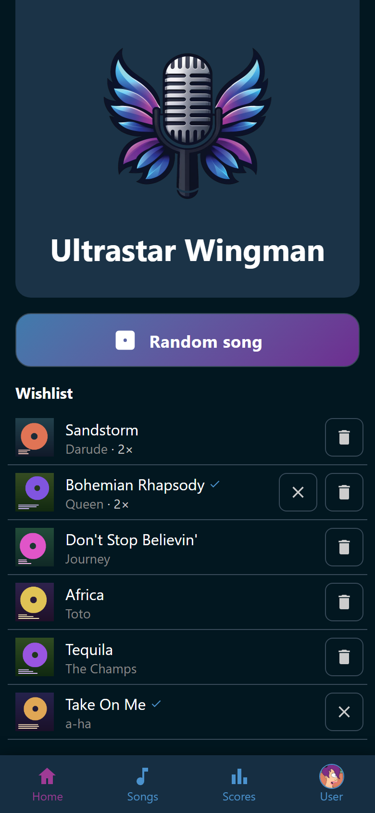

# Wish for a song

A wish means "somebody should sing this tonight". It is the whole room's list,
not yours, and it needs no account. The phone remembers who wished for what.

## Add a wish

1. Open a song from anywhere in Wingman. See
   [Open a song](../songs/song.md).
2. Tap :wingman-playlist-plus: **Wishlist** under the cover.

Its glyph turns into :wingman-playlist-check:, and the song appears on the
wishlist for everybody.

## Read the list

**Wishlist** on **Home** shows every wished song, the most wanted first. Two
marks can sit after a title:

- :wingman-heart: The song is one of your favorites.
- :wingman-check: This wish is yours.

A song more than one person wants carries its count after the artist, as
**· 3×**. Tap a row to open the song.

{ width="320" loading=lazy }
/// caption
Sandstorm and Bohemian Rhapsody each carry a count, because two people asked
for them.
///

The host screen carries the most wished songs beside the QR code, under **Most
wished**. The room can see what it asked for without looking at a phone. See
[The host screen](../host-screen/index.md).

## Take a wish back

Tap :wingman-close: **Take back your wish** on your own row. Everybody else's
wish for that song stays, and the count drops by one.

The party's helpers get :wingman-trash: **Take off the wishlist for everybody**
beside the row instead, for the wish the party is not going to sing. Trusted and
Admin hold that by default. It never appears where your own wish is the only
one, because taking your wish back already does exactly that. See
[Groups and permissions](../people/groups.md). The reel offers them the same
:wingman-trash: button beside the wished song it lands on, on the phone and
when it spins on the host screen. See
[Let the reel pick](reel.md#take-the-song-off-the-wishlist).

## What a wish does

A wish is a vote in two places.

- **The reel.** On **Wishlist (weighted)**, every wish adds to a song's chance.
  Each further wish of the same person counts a little less, so a long wishlist
  does not drown out a short one. See [Let the reel pick](reel.md).
- **The host screen.** **Most wished** is the room's own running order.

Starting a song takes it off the wishlist for everybody, whoever wished for it
and whoever sings it.

Somebody who went home and was hidden from the singer picker takes their wishes
with them. They are off the list and out of the reel until that player is shown
again or logs in. Their own phone still marks them. See
[Take somebody out of the picker](../people/players.md#take-somebody-out-of-the-picker).

!!! note
    Made an account later in the evening? The wishes from that browser move over
    to your account when you log in. Nothing is lost.
