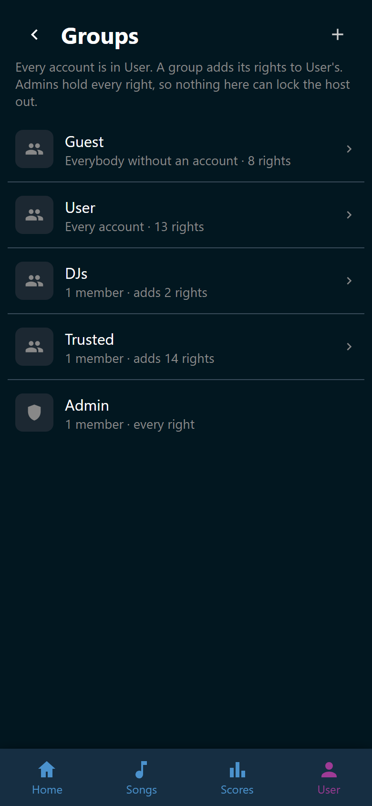
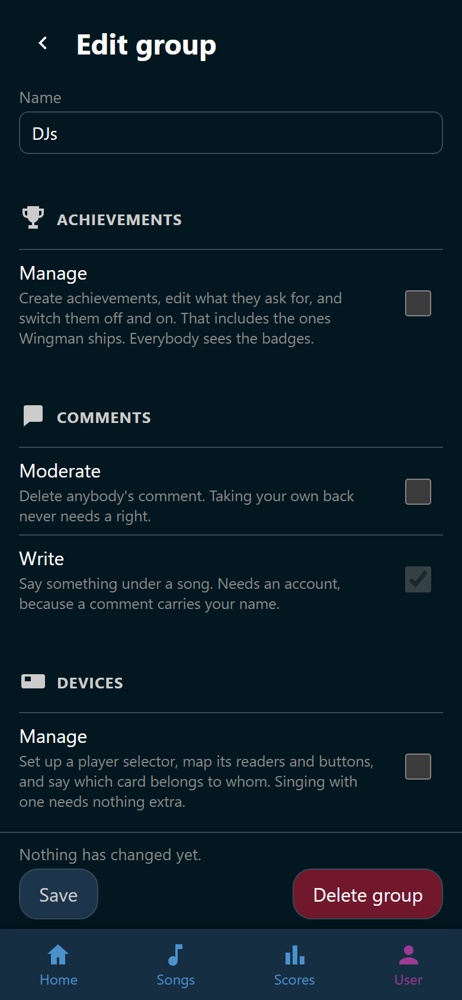

# Groups and permissions

Rights are handed out in groups. Everybody without an account is a **Guest**,
every account is a **User**, and the host decides what each of the two may do.
On top of that the host makes groups of their own, says what each one adds, and
puts accounts in as many as fit: **Trusted** for the helpers is there from the
start. An account holds what User holds plus what its groups add. **Admin** is
the host's own group: its members hold every right, always, and only an
administrator can put somebody in it. A right you do not hold yourself, you
cannot hand out.

Nothing in the app asks which group you are in. It asks whether you hold the
right, so the host can move any right to any group.

## The groups Wingman starts with

| Group | Who is in it |
|---|---|
| **Guest** | Everybody without an account, every guest phone included |
| **User** | Every account, from the moment it is registered |
| **Trusted** | The helpers an administrator puts in it |
| **Admin** | The first account ever created, and whoever an administrator puts in it |

Guest, User, and Admin are built in. They keep their names and cannot be
deleted. Trusted is a group like any you make yourself: rename it, change what
it adds, or delete it.

Guest's rights are not part of an account's. A right meant for everybody is
ticked under Guest and under User. That way the host can keep a right for
phones without an account alone, or take one from them without taking it from
the accounts.

An administrator always holds every right. That is not a setting, so no mistake
on the Groups page can lock the host out of their own app.

## What each group may do at the start

**Songs and downloads.** Everybody sees the song list and opens a song. Trusted
adds the rest: searching USDB, starting downloads, rescanning the song folders,
and fixing a song's title, artist, or year. Deleting a song erases its folder
from the disk, so it starts with Admin alone.

**The party.** Everybody starts a song, reads the wishlist, and adds a wish. An
account may stop the song that is running. Trusted may clear somebody else's
wish off the list, add and delete players, hide a player for the evening, and
change anybody's picture.

**Playlists and tags.** Everybody sees the shared playlists. An account makes
playlists of its own, because a playlist belongs to somebody. Trusted may change
and delete the party's shared lists, and any list somebody shared with them.
Trusted also creates tags, deletes them, and says who each tag is for.

**Scores and achievements.** Everybody sees the scoreboard of the party that is
running. An account also sees the parties before tonight and anybody's whole
record. Trusted may name a party. Admin alone may put a recorded score on
another singer or delete it, take a party off the list on the Scores tab, and
edit achievements.

**People and settings.** Trusted sees who has an account. Admin puts people in
groups, deletes accounts, opens the settings, and edits the groups.

**The player selector.** Admin alone sets a selector device up: adding one,
saying what each reader and button does, and giving cards to players. A card on
a reader picks the singer it belongs to, so this right decides who ends up on
the TV. The device itself carries a token of its own and is in no group.

**Background music.** Everybody sees what is playing between songs: it is the
room's own soundtrack. An account may pause it, skip a song, and change the
volume, because that changes what the whole room hears. Trusted switches the
music on and chooses what it plays from. See
[Play background music](../party/music.md).

**Comments.** An account writes them, because a comment carries a name. Trusted
deletes anybody's. See [Open a song](../songs/song.md).

## The Groups page

**User** > **Permissions** lists every group: Guest, User, the groups of the party by
name, and Admin last. Each row says who is in the group and what it gives.

{ width="320" loading=lazy }
/// caption
A group of your own counts only the rights it adds to User's.
///

Admin's row opens nothing. Its members hold every right, so there is nothing to
tick.

## Make a group

1. Open **User** > **Permissions**.
2. Tap :wingman-plus: **New group**.
3. Type a **Name**. It may be up to 32 characters, and no other group may have
   it, capitals aside. *Guest*, *User*, and *Admin* are taken.
4. Tick what the group adds.
5. Tap **Save**.

A new group has nobody in it. Put people in it on **Players & accounts**. See
[Players and avatars](players.md#groups).

## The group editor

Tap a group on the Groups page to open it. Every right is a row, under the part
of the app it belongs to, with a line saying what it allows. Tick a box to give
the group that right, and tap **Save**. The change holds from the next thing
anybody does in the app.

{ width="320" loading=lazy }
/// caption
A grayed-out tick is a right every account already holds through User.
///

Some boxes cannot be changed, and the box says why when you point at it:

- In a group of your own, a right User already gives is ticked and grayed out.
  Every account holds it, the group's members included.
- **Manage** under **Playlists** cannot be ticked for **Guest**. A playlist
  belongs to an account, so somebody without one has none to create.
- A right you do not hold yourself cannot be ticked, unless you are an
  administrator.

**Moderate** under **Playlists** only works alongside **Manage**. It reaches the
party's shared lists and the ones somebody shared with the holder. A private
list stays private.

To rename a group of your own, change its **Name** and tap **Save**. Its members
and everything granted to it stay. Guest and User keep their names.

## Delete a group

1. Open the group.
2. Tap **Delete group**, then **Delete**.

Its members lose the rights the group gave them. Their accounts stay, and so
does everything another group gives them. Deleting a group also takes it off
every tag it was named on. See [Tags](../tags/index.md).

## Two rules nobody can tick away

Rights can be handed to helpers safely, because two rules bind everybody but an
administrator:

- **Admin is an administrator's.** Only an administrator puts somebody in
  Admin, takes somebody out of it, or deletes an administrator's account.
- **You cannot hand out a right you do not hold.** A helper who may edit the
  groups may tick only the rights they hold themselves. A helper who may manage
  accounts may put somebody in a group only when they hold everything that
  group gives.

Taking away is never held back. A helper may untick a right, delete a group, or
take somebody out of a group other than Admin. An administrator can always put
it back.

!!! warning
    Guest and User may be given any right, managing the accounts and editing the
    groups included. Ticked under Guest, that hands it to every phone in the
    room. Keep those two rights in groups of your own.

!!! note
    Four things are yours and nobody grants them. Your favorites, the picture of
    the player you sing as, and the scores you sang yourself all belong to you.
    So does taking back a comment you wrote. No administrator can take those
    away.

## The host screen's own rights

The browser that traded the host link for host rights counts as an administrator
without an account. It holds every right, whatever the groups say. It owns
nothing, so favorites and playlists still need a real account. See
[The host screen](../host-screen/index.md).
