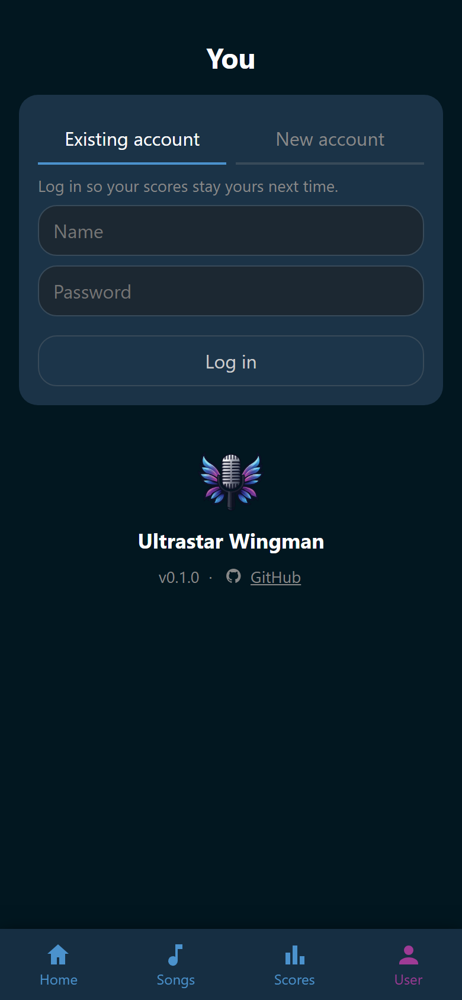

# People

Wingman keeps three things apart: a guest, an account, and a player. A guest is
anybody at the party without an account. An account is a name and a password
somebody registered. A player is the name a score is filed under.

Every account has a player of the same name. A guest sings as a player too, made
by whoever typed the name into the singer picker. So every score has an owner,
account or not.

## What an account adds

A guest phone browses the songs, wishes, and starts a song without logging in.
An account is for the things that belong to one person:

- favorites,
- playlists of your own,
- comments under a song,
- the parties before tonight, and a page of your own that gathers your record
  and your badges.

Scores and badges belong to the player, not to the account. A guest earns badges
by singing like anybody else. The account is what gives you a page to read them
on, on any browser you log in from.

An account also holds a role, and a role is how the host hands rights out.

## Log in or register

Signed out, the **User** tab is the login form.

{ width="320" loading=lazy }
/// caption
**New account**, beside the tab you land on, is the way to register instead.
///

1. Open the **User** tab.
2. To register, tap **New account**. **Existing account** is the way back to
   logging in.
3. Type your **Name** and your **Password**.
4. Tap **Log in**, or **Create account** when you are registering.

A name is 3 to 32 characters long and may hold anything, accents included. A
password is at least 8 characters.

Register under the exact name you sang as tonight and that player becomes yours,
with every score on it. Capitals make no difference. Registering a name nobody
sang under creates a new player instead.

You stay logged in on that browser for 90 days. Every visit pushes the date
further out, so the host does not log in again next weekend.

!!! warning
    The first account ever created is the administrator, because nobody could
    have granted it. Create yours before the party.

## Your own page

Once you are logged in, the **User** tab is you. It shows your picture with your
name beside it, your role under the name, and :wingman-log-out: **Log out** under
that. Tap the picture to
change it, which needs no right at all. With single sign-on, the provider's
picture stands there until you pick one of your own. See [Single sign-on](single-sign-on.md#the-picture).

Below stand your totals over every party you sang at, a link to your whole
record of scores, and the badges you hold. See [Scores](../scores/index.md) and
[Achievements](../achievements/index.md).

:wingman-log-out: **Log out** signs this browser out and leaves everything else
alone.

At the foot of the page stand the Wingman logo, the version this Wingman is
running, and a link to the project on GitHub. Quote that version in a bug
report.

## The host screen's browser

The browser the host opened with the host link is not an account. The **User**
tab names it **Host screen**, with the role **Admin** under it. It may change
every setting. It owns nothing, so it has no favorites, no playlists, and no
scores of its own.

**Log in as a user** puts the login form on that browser for whoever
wants their own account there. See
[The host screen](../host-screen/index.md).

## A guest's phone

The first wish somebody makes hands their browser a cookie that lasts a year.
Registering on that browser brings those wishes along to the account. See
[Let guests in](../start/join.md).

## The pages in this section

- [Players and avatars](players.md): who sings, their pictures, and how to take
  somebody out of the singer picker.
- [Roles and permissions](roles.md): the four roles, what each one may do, and
  where the exact rights are edited.
- [Single sign-on](single-sign-on.md): logging in through an identity provider
  instead of a Wingman password.
