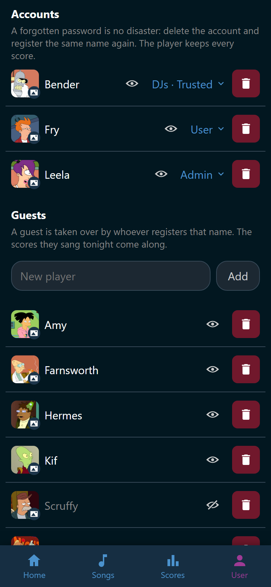

# Players and avatars

A player is the name a score is filed under. Everybody who sings is one, with an
account or without one. **User** > **Players & accounts** is where the host
looks after them.

The page opens for anybody holding one of the four rights behind it: adding
players, changing pictures, reading the accounts, or managing them. It shows
only what your rights cover. Trusted holds the first three by default, and
managing accounts is Admin's. See [Groups and permissions](groups.md).

## Accounts and guests

The page lists everybody in two sections.

- **Accounts** holds the people who log in. Their groups and their picture are
  here. An account that logs in through single sign-on says *Signs in with*
  and the sign-in button's name under its name. See
  [Single sign-on](single-sign-on.md).
- **Guests** holds the people who only sing. A guest is taken over by whoever
  registers that name, and the scores come along.

{ width="320" loading=lazy }
/// caption
Leela is the administrator here, and Bender is in Trusted and DJs.
///

## Add a player

Type the name into **New player** and tap **Add**. The name may be up to 64
characters and has to be free. Two players cannot share a name, capitals aside.

The singer picker carries the same **New player** box, so a missing singer is
added without leaving the song. See [Sing a song](../party/sing.md).

## Pictures

A player's picture stands next to their name here, in the singer picker, and in
Ultrastar Deluxe while they sing.

1. Tap the picture on the row. It carries :wingman-image: and opens the file
   picker.
2. Choose a jpeg, png, or webp file of at most 5 MB.

The new picture replaces the old one at once. There is one picture per player,
and Wingman keeps no history of them.

Changing somebody else's picture takes the right to do it. Changing your own
never does. Tap your picture on the **User** tab instead.

An account that logs in through single sign-on gets the provider's picture at
every login, until somebody uploads one here. An uploaded picture is never
replaced by a login after that. See [Single sign-on](single-sign-on.md#the-picture).

A file Wingman refuses says why under the row:

- *That image is larger than 5 MB.*
- *That picture has far too many pixels. Scale it down and try again.*
- *Only jpeg, png, and webp images work, and the file has to really be one.*

The last one also catches a file renamed to look like an image. Wingman reads
the bytes, not the extension.

## Take somebody out of the picker

Somebody who went home should not clutter the singer picker for the rest of the
evening.

1. Find their row.
2. Tap :wingman-eye: **Hide from player selection**.

Their name goes quiet and the eye grows a bar through it. Tap it again to bring
them back.

Hiding reaches the singer picker and the wishlist. The wishes they made with
their account leave the wishlist and the reel, and come back when they are shown
again. Wishes made on a phone without an account belong to no player and stay.
The scoreboard, the statistics, and every past party still name them, and their
scores are untouched. A slot somebody set earlier does not bring them back
either.

!!! note
    Logging in unhides you, and your wishes are back on the list. A singer who
    comes back after all does not have to ask anybody.

## Groups

Every account row names the account's groups beside it: **Admin** for an
administrator, otherwise the groups it is in, or **User** when it is in none.
The button is there for whoever may manage accounts, which is Admin by default.

1. Tap the groups on the account's row. **Groups of** and the name opens.
2. Tap a group to put the account in it. :wingman-list-check: marks the groups
   it is in.
3. Tap a marked group to take the account out again.

Every tap applies at once, on the account's own phone too. Each row says how
many rights the group adds to what every account holds.

Some rows cannot be tapped, and the row says why:

- *Only an administrator can change this* stands on **Admin** for anybody who is
  not an administrator.
- *Carries a right you do not hold* stands on a group that gives something you
  do not hold yourself. Taking somebody out of it is still allowed.

Nobody is put in **Guest** or **User**: every account is in User already. The
last administrator cannot leave **Admin** either. Wingman answers *There has to
be one administrator left.* See [Groups and permissions](groups.md).

## Delete somebody

An account and its player are deleted separately, and the account goes first.

- :wingman-trash: **Delete** on an account row keeps its player, as a guest.
  Every score it ever sang stays under that name. Deleting an account is
  Admin's. An administrator's account carries the button for administrators
  alone.
- :wingman-trash: **Delete** on a guest row removes the player. Recorded scores
  keep the name and belong to nobody. Trusted may do this.

Deleting an account takes its wishes, favorites, comments, and playlists with
it. A playlist that somebody else has admin access to is handed to that person
instead. See [Playlists](../songs/playlists.md).

The last administrator cannot be deleted. Make somebody else an administrator
first.

!!! note
    There is no password reset. Delete the account and register the same name
    again. The player row survives the deletion and is picked up by the new
    account, scores and all. A single sign-on account has no password in
    Wingman: its password is the provider's. Deleting one locks nobody out. The
    next sign-in asks for a name again.
