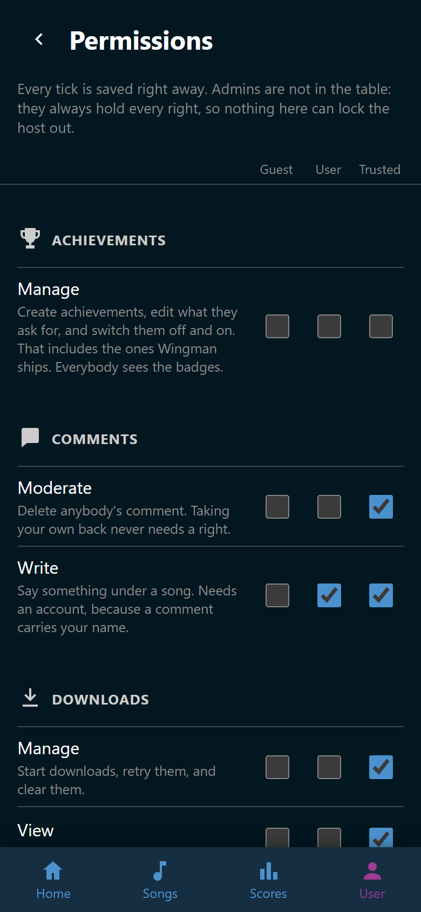

# Roles and permissions

A role is a bundle of rights. Wingman has four, and every account holds exactly
one. Nothing in the app asks what role you are. It asks whether you hold the
right, so the host can move any right to any role.

## The four roles

| Role | Who holds it |
|---|---|
| **Guest** | Everybody without an account, every guest phone included |
| **User** | Every account but the first, from the moment it is registered |
| **Trusted** | The helpers an administrator promotes |
| **Admin** | The first account ever created, and whoever an administrator promotes |

An administrator always holds every right. That is not a setting, so no mistake
in the permissions table can lock the host out of their own app.

## What each role may do by default

**Songs and downloads.** Everybody sees the song list and opens a song. Trusted
adds the rest: searching USDB, starting downloads, rescanning the song folders,
and fixing a song's title, artist, or year. Deleting a song erases its folder
from the disk, so it starts with Admin alone.

**The party.** Everybody starts a song, reads the wishlist, and adds a wish. An
account may stop the song that is running. Trusted may clear somebody else's
wish off the list, add and delete players, hide a player for the evening, and
change anybody's picture.

**Playlists and tags.** Everybody sees the shared playlists. An account makes
playlists of its own, because a playlist belongs to somebody. Trusted may change
and delete the party's shared lists, and any list somebody shared with them.
Trusted also creates tags, deletes them, and says who each tag is for.

**Scores and achievements.** Everybody sees the scoreboard of the party that is
running. An account also sees the parties before tonight and anybody's whole
record. Trusted may name a party. Admin alone may put a recorded score on
another singer or delete it, take a party off the list on the Scores tab, and
edit achievements.

**People and settings.** Trusted sees who has an account. Admin changes roles,
deletes accounts, opens the settings, and edits this table.

**The player selector.** Admin alone sets a selector device up: adding one,
saying what each reader and button does, and giving cards to players. A card on
a reader picks the singer it belongs to, so this right decides who ends up on
the TV. The device itself carries a token of its own and holds no role.

**Comments.** An account writes them, because a comment carries a name. Trusted
deletes anybody's. See [Open a song](../songs/song.md).

## The Permissions page

**User** > **Permissions** is the whole table, editable. Every right is a row,
grouped by the part of the app it belongs to, with a line under it saying what
it allows. The columns are **Guest**, **User**, and **Trusted**.

{ width="320" loading=lazy }
/// caption
Each right carries a line saying what it lets somebody do.
///

Every tick saves as it is made and says *Saved* next to the right it changed.
The rule holds from the next thing anybody does in the app.

Admins have no column. They hold everything, and that is what keeps the table
safe to experiment with.

Two boxes behave differently from the rest:

- **manage** under **playlists** cannot be ticked for **Guest**. A playlist
  belongs to an account, so somebody without one has none to create.
- **moderate** under **playlists** only works alongside **manage**. It reaches
  the party's shared lists and the ones somebody shared with the holder. A
  private list stays private.

!!! note
    Four things are yours and nobody grants them. Your favorites, the picture of
    the player you sing as, and the scores you sang yourself all belong to you.
    So does taking back a comment you wrote. No administrator can take those
    away.

## The host screen's own rights

The browser that traded the host link for host rights counts as an administrator
without an account. It holds every right in the table, whatever the ticks say.
It owns nothing, so favorites and playlists still need a real account. See
[The host screen](../host-screen/index.md).
