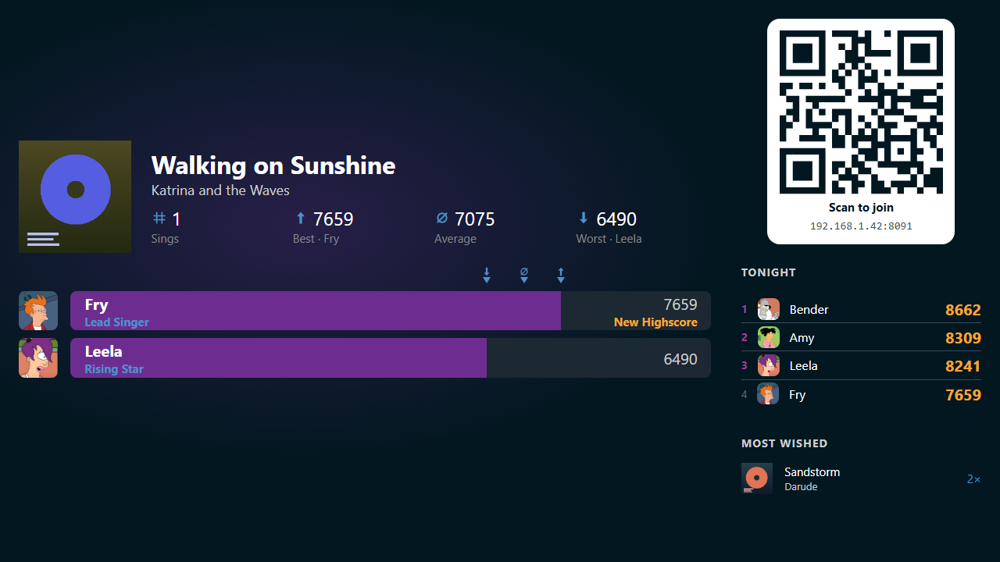

# Scores

Ultrastar Deluxe scores the singing. Wingman reads the result and files it under
the player who sang. The **Scores** tab is where the room reads it back.

## Where a score comes from

Ultrastar Deluxe keeps its scores in its own database. When it closes, Wingman
reads what is new in there. Wingman only reads that file. It never writes to it.

Each score lands on the player who stood on that microphone slot, so nobody has
to type a name. A name typed inside Ultrastar Deluxe instead of picked in
Wingman is recorded too. It stays a bare name and belongs to no player, so it
counts toward nothing else. See [Sing a song](../party/sing.md).

The host screen puts the result of the song that just finished on the TV.

{ width="720" loading=lazy }
/// caption
The four figures beside the cover are the song's whole record, not tonight's.
///

!!! warning
    A song that was stopped before the end scores nothing. That is Ultrastar
    Deluxe's rule, not Wingman's. The song still counts as played.

## One party is one evening

Wingman sorts sings into parties by itself. Everything sung within six hours of
the last song belongs to the same party. A longer break starts a new one. There
is nothing to open and nothing to close.

A party keeps its scores for good, and somebody may give it a name. What the
party that is going right now has played so far is also on the **Recent** chip
of the song list. See
[What has already been sung](../songs/index.md#what-has-already-been-sung).

## Which parties you can open

Three things decide what the **Scores** tab offers you.

- The party going on right now is open to everybody who may read scores. That
  is what a scoreboard at a party is for, and a guest phone holds it.
- Signed in, you also see every party you sang at yourself. That is identity
  rather than a permission. A party is yours once one of its scores is filed
  under your player.
- Every other party takes the right to read past parties, which an account
  holds by default and a guest phone does not.

The party picker holds exactly the parties you may open, so it never names one
only to refuse it. A guest phone has no player to go by and gets tonight alone.
See [Groups and permissions](../people/groups.md).

A party can also be taken off that list to keep it short. That reaches the
picker and nothing else: the party keeps every score it has, in your own
record, in a song's best scores, in the totals, and in what the achievements
are worked out from. See
[Take a party off the list](party.md#take-a-party-off-the-list).

## The pages in this section

- [A party's scores](party.md): the party picker, the charts, the ranking, the
  view of one sing, a picture to share of a party, a score, or a singer's stats,
  and the two corrections a moderator may make.
- [Your own scores](your-scores.md): your own record across every party, on the
  **User** tab.

What those scores earned is a section of its own. See
[Achievements](../achievements/index.md).
