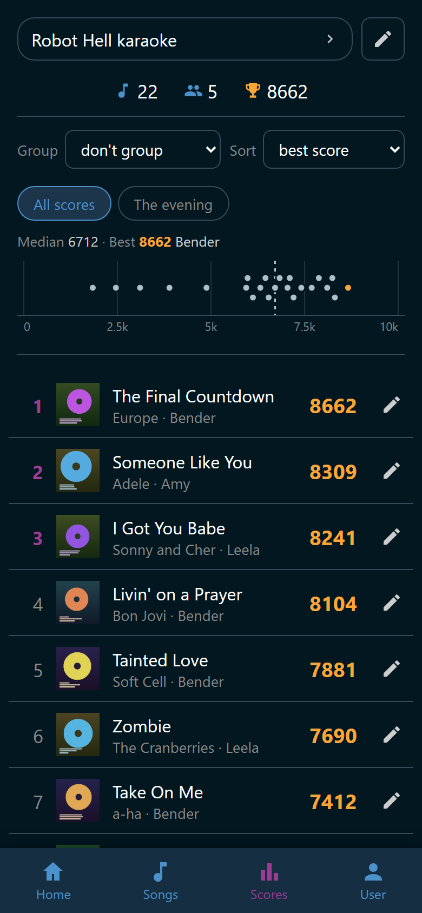
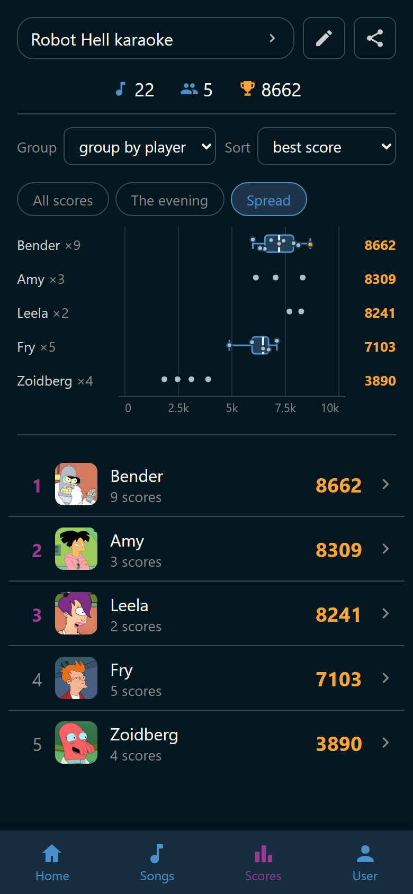
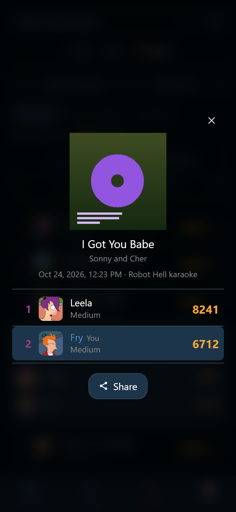
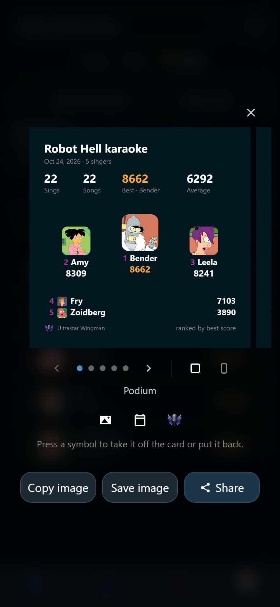

# A party's scores

The **Scores** tab shows one party at a time: what the room sang, how it went,
and who came out on top. Anybody at the party can read it.

{ width="320" loading=lazy }
/// caption
Bender's 8,662 is the evening's best, so the chart draws it in gold.
///

## Pick a party

The wide button at the top names the party you are on, and the tab opens on the
newest one. Tap it and a panel opens with one row per party. A row says the
party's name, or its date when nobody has named it. Under that stands the date,
how many people sang, and how many scores it holds.

With two parties or more, one extra row sits at the head of the panel and adds
them all up. It is called **All parties** for a reader who may open past
parties, and **All my scores** for everybody else. Its line says how many
parties that is and how many scores they hold together, the ones taken off the
list included, because picking it reads them too. Pick it and the whole page
reads that wider list. It is no single evening, so the figures below and the
rename button stay away. The panel holds exactly the parties you may open. See
[Scores](index.md#which-parties-you-can-open).

### Name a party

Naming a party takes the right to manage statistics, which Trusted and Admin
hold by default.

1. Pick the party you want to name.
2. Tap :wingman-pencil: **Rename party** beside the button.
3. Type a name, such as `Yannis' birthday`.
4. Tap :wingman-check: **Save**.

The name replaces the date everywhere the party is listed. To bring the date
back, empty the box and save again. :wingman-close: **Cancel** leaves the name
as it was.

### Take a party off the list

After a year of karaoke the panel is long. Taking a party off it takes the
right to hide parties, which Admin alone holds by default.

1. Open the panel.
2. Tap :wingman-eye-off: **Show every party** in the panel's header. The list
   now holds every party you may open, and each one carries an eye.
3. Tap :wingman-eye: beside a party to take it off the list. It turns into
   :wingman-eye-off: and the party's name goes quiet.
4. Tap it again to put the party back.

:wingman-eye: **Show every party** is the way out of that view: tap it and the
list is the short one again.

**Only that list changes.** The party keeps every score it has. It is still in
**All parties**, in each singer's own record, in a song's best scores, in every
total, and in what the achievements are worked out from. Nobody loses a badge
and nobody's best score moves.

The party going on right now can never be taken off the list. Tonight's
scoreboard is what the tab is for, and a phone at the party would be left with
an empty page.

Everybody in the room sees the change at once.

## The figures at the top

A row of numbers heads the party, each behind its own glyph. Rest the pointer
on one to read the word it stands for.

| Glyph | What it says |
|---|---|
| :wingman-calendar: **Started** | The day the party was. Only for a party that is not today's |
| :wingman-hash: **Sings** | How many performances were scored. Only when that differs from the number of songs |
| :wingman-music: **Songs** | How many different songs |
| :wingman-users: **Singers** | How many different people sang |
| :wingman-trophy: **Top score** | The evening's best score |

If more songs were started than were scored, the **Sings** word says so. It
reads "Sings: 2 scored of 4 started". A song that was stopped early is a sing
with no score.

## Group and sort

Two quiet selects sit under the figures and rearrange everything below them:
the charts and the list.

**Group** decides what a row stands for.

- **group by player** is one row per singer, with how many scores they have.
- **group by song** is one row per song, title over artist.
- **don't group** is one row per single score. The line under the title names
  the artist and whoever sang it.

**Sort** decides the order: **alphabetically**, **average score**,
**best score**, **chronological**, or **worst score**. Grouped by player,
**chronological** is not offered, because a singer is not a moment in the
evening. The number at the right of a row is the one being sorted on. Under
**alphabetically** and **chronological** the rows show the best score.

## The charts

Under the selects stands one chart, with up to three views to switch between.
Two scores are enough to draw it. Tap a view's name to switch. The view you
pick stays picked when you open another party.

- **All scores** puts every score of the party on one scale from 0 to 10000,
  one gray dot each. Two dots that came out nearly the same step aside instead
  of hiding each other. The dashed line is the party's median, and the gold dot
  is the best score. The line above the chart gives both numbers and names the
  singer of the best one.
- **The evening** spreads the same scores over the clock, so a warm-up and a
  late run are both visible. The five singers with the best scores get a color
  each, named in the legend above. Everybody else shares gray and is counted
  as "N more".
- **Spread** draws the first eight rows of the list, in the order the list has.
  Each line starts with the singer or the song, and ends with that row's best
  score. It is there only while the list is grouped and has two rows or more.
  Ungrouped, **All scores** already shows every score.

{ width="320" loading=lazy }
/// caption
Bender's nine scores earn a box, and Leela's two get plain dots instead.
///

In **Spread**:

- A singer with five scores or more gets a box plot. The box holds the middle
  half of their scores, the line in it is the median, and the whiskers reach
  their ordinary best and worst. A score far outside all of that stands alone
  past the whisker, and every single score is a small gray dot on top.
- A singer with fewer scores gets the dots alone. Four scores are four scores,
  not a distribution.
- A song is usually one performance, so its line shows one mark per score,
  wearing the singer's initial. From eight scores on, the initials give way to
  plain dots.
- The party's best score is gold here too.

Rest the pointer on a mark to read the singer, the song, the score, and the
time. On a phone, tap near a mark instead. Tap it again, or anywhere beside the
marks, to put the label away.

**All parties** and **All my scores** are no single evening, so they offer no
**The evening**. Their labels carry the date as well as the time.

## The ranking

The list under the charts is the page itself, and its rows are numbered from
the top. Under **best score** and **average score** the first three numbers
stand out, because the order really is a ranking. Tap a grouped row and it
unfolds into a card.

A row with more than one score behind it is headed by the same figures the
**User** tab prints over your own record: :wingman-hash: **Sings**,
:wingman-music: **Songs**, :wingman-arrow-up: **Best**,
:wingman-average: **Average**, and :wingman-arrow-down: **Worst**.

- **Sings** counts performances, not scores. A duet two people sang together
  is one sing and two rows in the list below it.
- **Songs** stands under a singer only. Under a song it would read **1** on
  every row, so it is left out there.
- Under a song, **Best** and **Worst** name the singer who managed them. Under
  a singer they name nobody: the row above is already their name.

From four scores on, a bar chart shows where they land. Under all of it stands
every single score behind the row: the songs that singer sang, or the singers
of that song.

Grouped by song, the cover on a row opens the song. Every single score opens
its sing: the rows inside an open card, and every row when the list is not
grouped.

## One sing

Tap a score and its sing opens over the page: the song, when it was sung, and
everybody who sang it with what they got.

{ width="320" loading=lazy }
/// caption
Fry tapped his own score, so his row is lit. Tapping Leela's would share hers.
///

- The line under the song gives the day and time the sing started, then the
  party's name. A party without a name gives the day and time alone.
- The rows are best first. The number in front of a row is the place that
  score took, so two singers on the same score share one. A sing one person
  sang alone has no place at all. Your own row says **You**.
- Tap the song's title to open the song. A song you may not open, or one that
  has left the library, is plain text.
- :wingman-share: **Share** makes a card of the lit row's score. See
  [Share a party or a score](#share-a-party-or-a-score).

Somebody who may correct scores still does that from the row on this page,
never from inside the sing. See [Correct a score](#correct-a-score).

## Share a party or a score

Wingman draws a picture of a party, of one score, or of one singer's scores
for you to send to friends. Your browser draws it, and you save or share it
from there. Whoever may read a party's scores may share them.

- To share the party, tap :wingman-share: **Share this party** at the end of
  the party button's row. **All parties** and **All my scores** have none,
  because a card is one evening.
- To share a score, tap it to open its sing, then tap :wingman-share:
  **Share**. The card is of the row that is lit there, so a duet partner's
  score is shared the same way as your own.
- To share one singer's figures, set **Group** to **group by player** and
  open their row. :wingman-share: **Share stats** stands under their figures,
  over their scores. The card is of that singer at this party. Under **All
  parties** or **All my scores** it adds up every party on the page, and the
  card says **All parties**. A row grouped by song has no **Share stats**.
  Your own record has the same card on the **User** tab, see
  [Share your stats](your-scores.md#share-your-stats).

{ width="320" loading=lazy }
/// caption
The picture is the card exactly as it is sent. Swipe it to see the other
designs.
///

The picture is one of the card's designs, and the next one peeks in at the
edge. Swipe the picture sideways to go through them, or tap
:wingman-chevron-left: **Previous design** and :wingman-chevron-right:
**Next design** under it. On a keyboard, the left and right arrow keys do the
same once the picture has the focus. The dots between the arrows show how many
designs there are and which one you are on, and its name is written under
them. The design you see is the one that is sent.

| Card | Designs |
|---|---|
| A score | **Dark**, then **Cover**, which blurs the song's cover behind it |
| A party | **Podium**, with the next singers listed under it. **Strip**, with every score of the party as a dot under it. **Mosaic**, which lays the party's covers behind the whole card, dimmed so the words stay readable. **Spread**, which puts every singer's scores side by side instead of the podium. **You**, which shows you alone, with your own figures and your place, such as "2nd of 5" |
| A singer's stats | **Histogram**, a bar chart of where the scores land, the bar with the best one in gold. **Strip**, every score as a dot. **Songs**, the singer's best score on each song, best first: five on a square, eight on a story |

On a story, **Podium** lists the next singers, and **Strip** has room for the
list and the dots both.

A design the card cannot draw keeps its place as an empty box with a line
saying why: **Mosaic** needs four different covers, for example, a song
without a cover has no **Cover**, and **You** is there for somebody who sang
at that party. A singer's **Histogram** and **Strip** need four scores, and
**Songs** needs two different songs. Its dot is a ring. While it is on
screen, the buttons at the foot wait.

The two symbols at the end of the dots choose the card's shape:
:wingman-format-square: **Square** for a chat, :wingman-format-story:
**Story** for a story app, which draws its own controls over the top and the
foot. The one in white is the one in use.

### Choose what goes on it

Under the design's name, three symbols say what goes on the card. They are
the same three, in the same order, on every design. Tap one to take it off the
card: it turns gray and is crossed out. Tap it again to put it back. The line
under them says what the last one you touched does.

| Symbol | On | Off |
|---|---|---|
| :wingman-image: **Other singers' pictures** | Everybody's picture | Everybody else is drawn as their initial. Your own picture is always yours |
| :wingman-calendar: **Party name and date** | The party's name and its day. On a singer's card, the line under their name, which may read **All parties** | The card names no party and no day. A party card then starts with its figures, and a singer's name stands alone. The saved file is still named after the party, or after its date, so you can find it on your phone |
| The logo itself, **Wingman logo** | The logo and the Ultrastar Wingman name in the bottom corner | Both go, and nothing else on the card moves |

A symbol a design has no use for stays where it is, faded, and keeps your
choice for the designs that do. The line says why when you tap it: your own
score, your own stats, **You**, and a party you sang alone show no other
singer, and **Spread** draws names rather than pictures.

The panel remembers the shape, the design, and the three symbols on this
device, and opens on that design the next time. **Spread** and **You** are not
remembered: the panel opens on the design you had before them. A singer's
card keeps its own design apart from the party card's. When the card cannot
draw the design it remembers, it opens on the first one it can.

### What a card shows

A score card shows the song, the score with its rating word, your place, and
who sang it with you.

A party card opens with the party's name over its date and how many sang. A
party without a name opens with its date. Then come **Sings**, **Songs**,
**Best**, and **Average**, and the podium. No card ever shows the worst score:
a card leaves the room.

A singer's card opens with their picture and name over the party's name and
date, or **All parties**. Then come the same four figures, and the design.
**Best** names nobody, because the whole card is one person's.

For a reader who may open past parties, a score that holds the song's record
says **New Highscore**. One that is the singer's own best on the song says
**Personal best**. Everybody else's cards carry neither.

### Save it or send it

The buttons under the choices are the ones your browser can carry out.

- **Share** hands the picture to your phone's share sheet.
- **Copy image** puts it on the clipboard, ready to paste into a chat.
- **Save image** downloads it. On an iPhone a download usually lands in
  **Files** rather than in your photos.

**Share** and **Copy image** need a secure connection, so a phone on the home
network usually has **Save image** alone. Press and hold the picture instead, and the
phone offers to save it to your photos or share it. The panel says so above the
picture on such a phone.

## Correct a score

Ultrastar Deluxe files a score under whoever was on that microphone slot, and
sometimes that was the wrong person. Correcting one takes the right to moderate
statistics, which Admin alone holds by default. Everybody looking at the page
sees the correction at once. A row that is one single score then carries
:wingman-pencil: **Correct the score**. Set **Group** to **don't group**, or
open a group, and every row is one score.

Tap it and **Correct this score** opens. The panel names the score and holds
both repairs.

- The list of players stands first. Tap the one who really sang it, then
  confirm with **Move**. The score keeps its number, its song, and its place in
  the party.
- **Delete score** at the foot takes it off the record after a confirmation.
  The song stays in what was played.

**Cancel** in either confirmation comes back to the panel, so a slip costs
nothing.

The number and the song are never editable. Those are what Ultrastar Deluxe
reported.

## When there is nothing to show

Before the first party of all, the tab says "Sing a song and the results land
here". A party where songs were started but nothing was scored says how many
were started. It also says that Ultrastar Deluxe reports a score only when a
song runs to the end.
