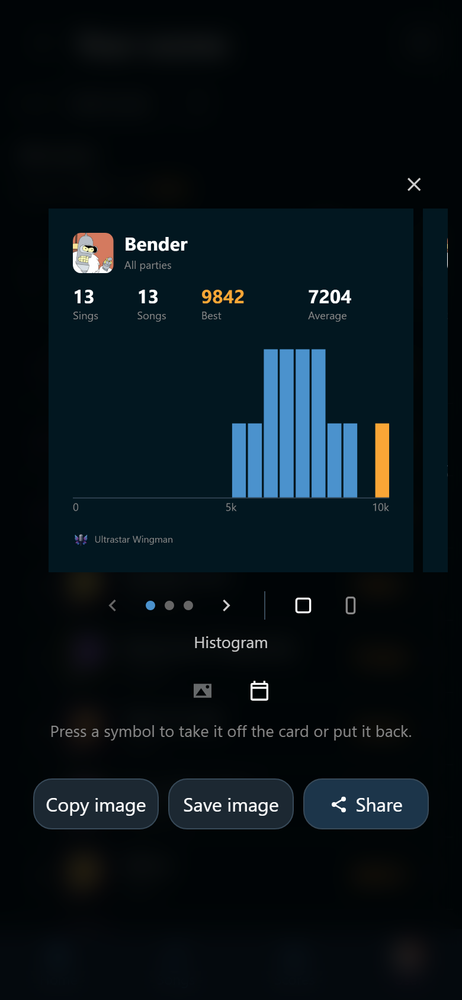

# Your own scores

The **Scores** tab is one party at a time. Your own record is not. It lives on
the **User** tab, and it needs an account.

## The numbers on your page

Log in and open **User**. Under your name stands an overview of your whole
record, every party included. Wingman draws the same overview wherever a phone
adds a set of scores up, so an open row on the **Scores** tab and a song's own
ranking read the same way.

| Figure | What it counts |
|---|---|
| **Sings** | How many times you sang. A duet you sang with somebody counts once |
| **Songs** | How many different songs |
| **Best** | Your best score ever |
| **Average** | The mean of all your scores, as a whole number |
| **Worst** | Your lowest score ever |

The first line reads like "12 sings · 9 songs". From four scores on, a bar
chart under it shows where your scores land across the full range, and
**Best**, **Average**, and **Worst** are lines through its bars with their
numbers over the chart. Best is the gold line, and its bar is gold too. With
fewer than four scores the three numbers stand on one line instead. Before your
first score the page says "Sing a song and your stats appear here."

**Best** and **Worst** name nobody here. Every score on this page is yours, so
the name would be your own twice.

{ width="320" loading=lazy }
/// caption
The gold bar at the right of the chart holds that best of 9,842.
///

## Your scores, party after party

Tap **All my scores** under the overview. The page is called **Your scores**,
and it holds every score you ever got.

{ width="320" loading=lazy }
/// caption
Rap God at 9,842 sits a long way past his median of 7,205.
///

One row is one song you sang, so the only control is **Sort**:
**alphabetically**, **average score**, **best score**, or **worst score**.
There is no **chronological** here, because a row is a song rather than a
moment in one evening.

From two scores on, the **All scores** chart of the **Scores** tab is drawn
under the select, over your whole record. Every score is one dot, your best is
gold, and the dashed line is your median. The line above the chart gives your
median and your best. Its labels carry the day as well as the time, so two
runs of one song months apart still read apart.

Tap a row for what that song adds up to. A song you sang more than once is
headed by the same overview as the **User** tab, minus the song count: every
row here is one song, so counting them would print "1 song" on every row. From
four runs on, the bar chart with its **Best**, **Average**, and **Worst** lines
follows. Under that stands every single run with the day and
time it happened. Tap one to open its sing: who sang it with you that time,
what they got, and :wingman-share: **Share** for a card of it. See
[One sing](party.md#one-sing). The cover on the row opens the song.

!!! note
    **All my scores** on the **User** tab is your own record. The row with the
    same name in the party picker on the **Scores** tab is something else. That
    one adds up every party you may open, with everybody who sang in them.

## Share your stats

Tap :wingman-share: **Share my stats** at the right of the **Your scores**
heading. Wingman draws a card of your whole record: your picture and name over
**All parties**, then **Sings**, **Songs**, **Best**, and **Average**. The
worst score is never on a card. The button is there once you have four
scores, or scores on two different songs.

{ width="320" loading=lazy }
/// caption
The gold bar holds Bender's best of 9,842.
///

Swipe the picture for the three designs:

| Design | What stands under the figures |
|---|---|
| **Histogram** | A bar chart of where your scores land. The bar with your best is gold |
| **Strip** | Every score as a dot, your best in gold, and your median |
| **Songs** | Your best score on each song, best first: five on a square, eight on a story |

**Histogram** and **Strip** need four scores. **Songs** needs two different
songs. A design that cannot be drawn yet keeps its place with a line saying
why. With fewer than four scores, all of one song, none of them can be drawn,
so there is no **Share my stats** yet. The rest of the panel works as it does
for a party card: the shape, the two symbols, and the buttons. See
[Share a party, a score, or a singer's stats](party.md#share-a-party-a-score-or-a-singers-stats).
On your own card the pictures symbol is faded, because your own picture is
always on it.

To share your stats at one party only, or somebody else's, use :wingman-share:
**Share stats** on the **Scores** tab with the rows grouped by player.

## One song's best runs

A song's own view has the same thing for one song. :wingman-trophy:
**Best scores** opens its whole history and the ten best runs of all time. It
reaches back over every party, so it takes the right to read past parties. See
[Open a song](../songs/song.md).

## What a guest gets

A guest phone earns scores like anybody else. They are filed under the player
somebody picked on the microphone slot, and they show up in the party's
ranking and on the host screen.

This page is the part that needs an account. Signed out, **User** shows the
login form. An account that is not linked to a player yet says so, because a
score hangs on a player.
