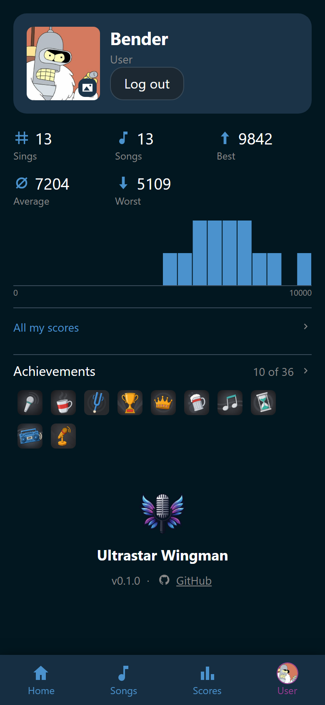
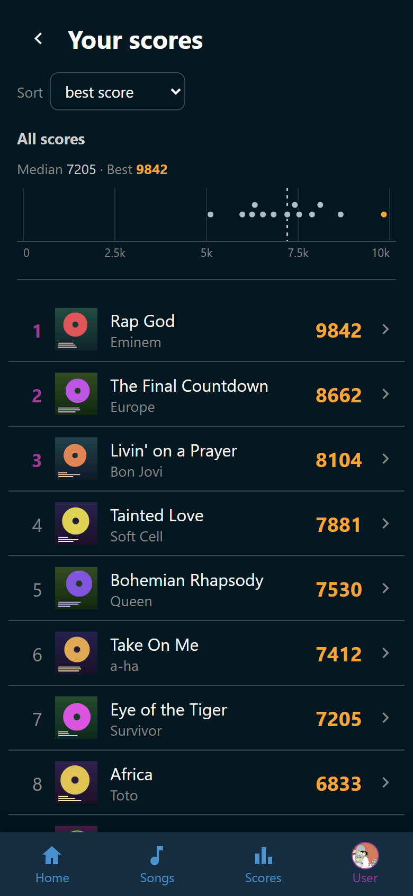

# Your own scores

The **Scores** tab is one party at a time. Your own record is not. It lives on
the **User** tab, and it needs an account.

## The numbers on your page

Log in and open **User**. Under your name stand five figures over your whole
record, every party included. Wingman uses the same figures in the same order
wherever it adds a set of scores up, so an open row on the **Scores** tab and a
song's own ranking read the same way.

| Figure | What it counts |
|---|---|
| :wingman-hash: **Sings** | How many times you sang. A duet you sang with somebody counts once |
| :wingman-music: **Songs** | How many different songs |
| :wingman-arrow-up: **Best** | Your best score ever |
| :wingman-average: **Average** | The mean of all your scores, as a whole number |
| :wingman-arrow-down: **Worst** | Your lowest score ever |

**Best** and **Worst** name nobody here. Every score on this page is yours, so
the name would be your own twice.

From four scores on, a bar chart under the figures shows where your scores
land across the full range. Before your first score the page says "Sing a song
and your stats appear here" instead.

{ width="320" loading=lazy }
/// caption
The lone bar at the right of the chart is that best of 9,842.
///

## Your scores, party after party

Tap **All my scores** under the figures. The page is called **Your scores**,
and it holds every score you ever got.

{ width="320" loading=lazy }
/// caption
Rap God at 9,842 sits a long way past his median of 7,205.
///

One row is one song you sang, so the only control is **Sort**:
**alphabetically**, **average score**, **best score**, or **worst score**.
There is no **chronological** here, because a row is a song rather than a
moment in one evening.

From two scores on, the **All scores** chart of the **Scores** tab is drawn
under the select, over your whole record. Every score is one dot, your best is
gold, and the dashed line is your median. The line above the chart gives your
median and your best. Its labels carry the day as well as the time, so two
runs of one song months apart still read apart.

Tap a row for what that song adds up to. A song you sang more than once is
headed by the same figures as the page above, minus **Songs**: every row here
is one song, so counting them would print a **1** on every row. A bar chart
follows from four runs on. Under that stands every single run with the day and
time it happened. Tap one to open the song.

!!! note
    **All my scores** on the **User** tab is your own record. The row with the
    same name in the party picker on the **Scores** tab is something else. That
    one adds up every party you may open, with everybody who sang in them.

## One song's best runs

A song's own view has the same thing for one song. :wingman-trophy:
**Best scores** opens its whole history and the ten best runs of all time. It
reaches back over every party, so it takes the right to read past parties. See
[Open a song](../songs/song.md).

## What a guest gets

A guest phone earns scores like anybody else. They are filed under the player
somebody picked on the microphone slot, and they show up in the party's
ranking and on the host screen.

This page is the part that needs an account. Signed out, **User** shows the
login form. An account that is not linked to a player yet says so, because a
score hangs on a player.
