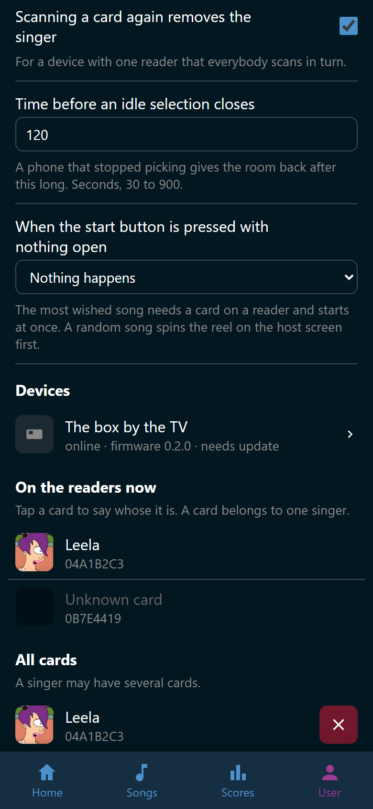
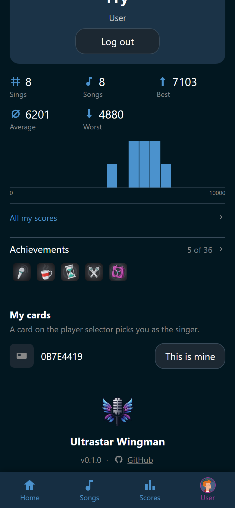

# Cards and players

A card stands for one singer. While it lies on the device, Wingman picks that
singer for the next song. **User** > **Player selector** is where you say which
card belongs to whom. The host reaches the same page from **Manage** on the host
screen.

The page opens for whoever may set the player selector up, which is Admin by
default. See [Roles and permissions](../people/roles.md).

## Give a card to a singer

The device has to be connected for this. **On the readers now** lists what is
lying on a box that is talking to Wingman, and nothing else.

1. Put the card on a reader.
2. Open **User** > **Player selector**.
3. Find the card under **On the readers now**. A card nobody has claimed reads
   **Unknown card**, with its number under the name.
4. Tap the row. The **Who holds this card?** picker opens.
5. Tap the singer. The picker closes and the card is theirs.

{ width="320" loading=lazy }
/// caption
Two cards are lying on the box. Wingman knows one of them.
///

The page says the same thing over the list: *Tap a card to say whose it is. A
card belongs to one singer.*

Under **All cards** you get everything Wingman knows, one row per card. A singer
may have several cards, so a fob on a keyring and a card in a wallet both work
for the same person. Tap a card under **On the readers now** again to hand it to
somebody else.

## Take a card back

1. Find the card under **All cards**.
2. Tap :wingman-close: **Forget card**.
3. Confirm **Forget this card?** with **Forget**.

The dialog names the singer the card stops being, and adds: *Their scores and
their player stay exactly as they are.* Only the card goes.

## Claim your own card

A singer with an account takes a card without asking anybody. **My cards** sits
on the **User** tab, below your scores and badges. It appears once a card is
lying on the selector, or once the account already holds one.

{ width="320" loading=lazy }
/// caption
A card nobody holds shows up here by its number.
///

1. Put the card on a reader.
2. Open the **User** tab and find the card's number under **My cards**.
3. Tap **This is mine**. The card is yours from that moment.

A card somebody else holds is refused with *Somebody else already holds that
card.* Your own cards stand below, each with :wingman-close: **Forget card**,
which takes the card off you and changes nothing else. An administrator still
assigns and takes back any card on **User** > **Player selector**.

## A card Wingman does not know

A card with no singer still fills a slot. During player selection the slot reads
*Unknown card*, on the phone and on the TV. Nobody is scored for it, so the song
does not start on its own while a slot reads that.

Give the card a name under **On the readers now**. The slot fills with the singer
while the card lies where it is.

A slot a card holds is the card's. No phone clears it or points it at somebody
else, and lifting the card off the reader is what frees it.

## Start the song on its own

Turn on **Start the song on its own** to let the room start a song without
touching anything. Its line says: *When every slot holds a known singer, the
song starts after the delay below.*

**Delay before the song starts** is that delay, in seconds, from 0 to 30. Its
line says why it exists: *Time to take a wrong card away.* The countdown ends
the moment a card leaves a slot, and it runs again once the slots are full.

## Scanning a card again removes the singer

Turn on **Scanning a card again removes the singer** for a box where everybody
scans at one reader in turn. Its line says: *For a device with one reader that
everybody scans in turn.* A singer who is already on a slot leaves it when they
scan a second time.

With it off, a second scan does nothing at all. The setting has nothing to say
about a device that gives each slot its own reader.

## Time before an idle selection closes

The phone that opened the player selection holds it. This setting is how long
the room waits before taking it back, in seconds, from 30 to 900. Its line
says: *A phone that stopped picking gives the room back after this long.*

## When the start button is pressed with nothing open

A press on a **Start the song** button while nobody is picking can pick a song
on its own. This setting says which one. Its line says: *The most wished song
needs a card on a reader and starts at once. A random song spins the reel on
the host screen first.*

- **Nothing happens**, which is how a fresh Wingman is set.
- **Start the most wished song** takes the top of the wishlist. The singers are
  the cards lying on the readers, and the song starts on the press. With no
  card on a reader, the press does nothing at all.
- **Start a random song** spins the reel on the TV, with or without a card on a
  reader. The next press starts the song if a card stands on a slot, and spins
  again if none does. A spun song never starts on its own, whatever **Start the
  song on its own** says.

Two settings appear under it for a random song. **Pick the random song from**
is what the reel spins over: **All songs**, **Wishlist**, **Wishlist
(weighted)**, or **A playlist**. Its line says: *The reel spins even with no
card down. The next press starts the song if somebody stands on a slot, and
spins again if nobody does.* **Playlist to pick from** appears for a playlist.
Its line says: *A playlist that no longer exists falls back to all songs.* So
does an empty one.

The reel picks by the rules on [Let the reel pick](../party/reel.md), as a
guest sees the library. A song a tag hides from guests cannot win.

!!! note
    Cheap batches of cards sometimes repeat a number, and two cards with the
    same number are one card to Wingman. A phone cannot stand in for a card
    either. Both are in [Build the device](build.md).
