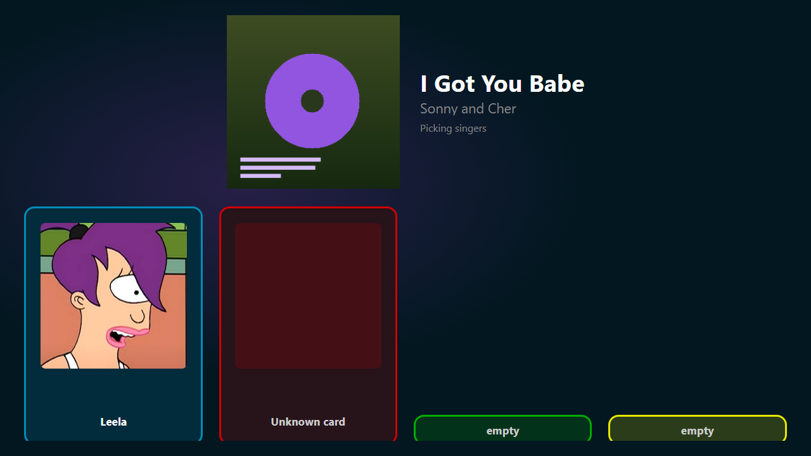

# Player selector

The player selector is a box that stands in the room, with a colored slot for
each microphone. A singer puts their card on a slot, and Wingman picks them for
the next song. You build it yourself out of an ESP32 board, up to six RFID
readers, and up to four buttons.

An evening with it runs like this: the cards go down, somebody picks a song, and
the TV shows the slots filling up. The song starts on a button at the device, or
on its own once every slot is filled.

{ width="720" loading=lazy }
/// caption
An empty slot is a short box along the foot of its row, and it grows as somebody takes it.
///

A strip of lights beside the readers is optional. It says what the TV says:
which slot is taken, and which card Wingman does not know.

Three settings let the box act on its own. **When the start button is pressed
with nothing open** turns a press into the most wished song, or into a spin of
the reel on the TV. A second press confirms the spin. **When the cancel button
is pressed with nothing open** skips to the next background song. **Time before
an idle selection closes** is how long a phone keeps the room before it gives
it back. All three are on **User** > **Player selector**.

## The pages in this section

- [Build the device](build.md): the parts, the wiring, the two reader layouts,
  and the hardware that gives trouble.
- [Set up the device](setup.md): flash the firmware, give it your Wi-Fi and the
  karaoke PC's address, then map its readers onto your slots.
- [Cards and players](cards.md): which card belongs to whom, several cards per
  person, and what happens with a card Wingman does not know.
