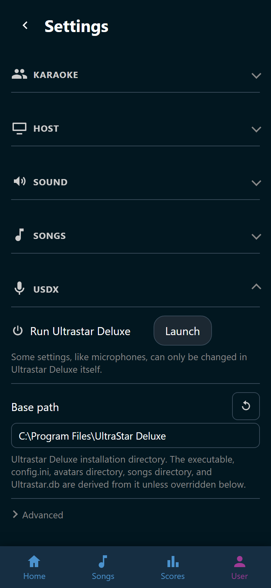

# Settings

**User** > **Settings** holds everything Wingman is configured with. Two fields
are all it really needs before the first song: the Ultrastar Deluxe base path
and the songs directory. A Wingman that comes with its own Ultrastar Deluxe
asks for neither. The rest has sensible defaults. See
[Connect Ultrastar Deluxe](../start/ultrastar-deluxe.md).

Changing a setting takes the right to manage settings, which Admin holds by
default. The host screen's browser holds it too.

A role that may look but not change sees every box grayed out. The page says so
in one line: *You can see the settings but not change them.*

## How the page is laid out

The settings stand in groups, each one behind its own icon and heading:
**Karaoke**, **Host**, **Sound**, **Songs**, **USDX**, **USDB**,
**Downloads**, and **Auth**. Every group is open when the page opens. Click a
heading to fold one away.

A group that carries settings a normal setup never touches ends in an
**Advanced** line. Those are overrides of things Wingman works out on its own.
Click the line to fold them out.

Each setting shows its name, its box, and one line saying what it does.

{ width="320" loading=lazy }
/// caption
The **USDX** group is open, and every other group is folded away.
///

## Change a setting

1. Type into the box.
2. Leave the field, or press ++enter++.

*Saved* appears next to the name, and every open browser has the new value at
once. A checkbox or a list saves the moment you pick. A box that holds several
lines saves when you leave it, because ++enter++ starts a line there.

A setting that no longer holds its default grows :wingman-refresh: **Reset**
next to its name. It puts the default back and says what that default is when
you point at it.

Most settings take hold at once. These do not:

- **Parallel** in the **Downloads** group is read when Wingman starts, so a new
  number applies after a restart.
- **Directory** and **Additional directories** in the **Songs** group say where
  Wingman looks. The song list catches up on the next scan, so click
  :wingman-refresh: **Rescan** on the **Songs** tab once you have changed one.

## Passwords and secrets

**Password** in the **USDB** group and **OIDC client secret** in the **Auth**
group are stored and never shown again. Once one is set, its box reads
*(unchanged)* and typing nothing keeps it. :wingman-refresh: **Clear** next to
the name empties it.

## Two things that live elsewhere

Not everything a host configures is on this page. Two features keep their
options next to the feature itself.

- Whether badges exist at all, and how long the host screen holds a row of them,
  sit at the top of **User** > **Achievements**. See
  [Manage achievements](../achievements/manage/index.md).
- The built-in marks and facets, such as the heart and the decade filter, sit
  under **Built-in** on **User** > **Tags**. See
  [Built-in marks and facets](../tags/built-in.md).

## The pages in this section

- [All settings](reference.md): every setting Wingman has, one table per group.
