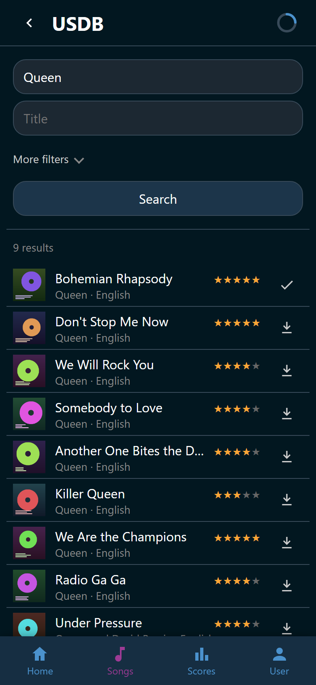
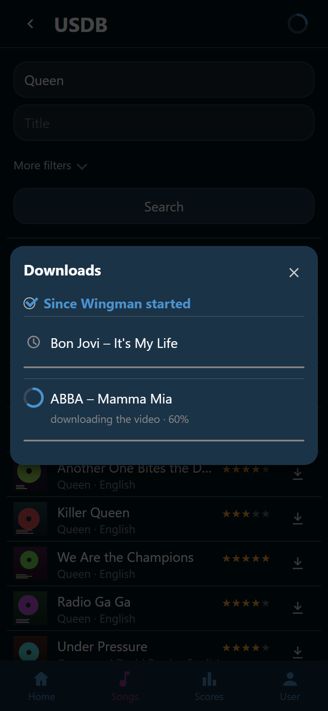

# Download songs

New songs come from USDB, the community song database at usdb.animux.de.
Wingman searches it, downloads the whole song, and puts it into your song
folder.

Open the **Songs** tab, tap :wingman-plus: **Add songs**, and pick **USDB**.

## Set up the USDB account

USDB only answers logged-in accounts, so Wingman needs one of its own.

1. Create a free account at usdb.animux.de.
2. Open the **USDB** page. Without credentials it says *Wingman has no USDB
   account yet*.
3. Type the username and the password into the form and tap **Log in**.
   Wingman saves both and tries the login straight away.
4. The login form disappears once it worked, and the search is usable.

The two are the **Username** and **Password** settings in the **USDB** group,
so they can also be filled in under **User** > **Settings**. The password is
stored and never shown again: the field only says whether one is set. See
[Settings](../settings/index.md).

!!! note
    Only somebody who may change settings gets the login form. Everybody else
    reads why USDB cannot be used and nothing more.

## Search

Fill in **Artist**, **Title**, or both, and tap **Search**. Best rated songs
come first.

{ width="320" loading=lazy }
/// caption
Bohemian Rhapsody carries a check, so that one is already in the library.
///

**More filters** holds two more controls. **Results per page** offers 30, 50,
or 100. **Sort by** offers ten orders, in five pairs:

- **Best rated** and **Worst rated**
- **Newest first** and **Oldest first**
- **Artist A to Z** and **Artist Z to A**
- **Title A to Z** and **Title Z to A**
- **Most viewed** and **Least viewed**

Changing either control searches again at once.

**Previous** and **Next** page through the results. USDB often does not say how
many pages there are. The pager then reads *Page 3* rather than *3 / 12*, and
stepping past the last page is how you find the end.

## A result row

A row carries the cover, the title, the song's rating out of five stars, and
the artist with its language. On the right sits one mark that says where the
song stands:

| Mark | What it means |
|---|---|
| :wingman-download: | Not in your library. Tap it to download the song |
| :wingman-clock: | Waiting in the queue |
| A turning ring | Downloading, with the percentage in the ring |
| :wingman-check: | In your library |
| :wingman-alert: | The download failed. Tap it to read why, and to try again |

A song already in your library opens the normal song view when you tap the row.
Play it, favorite it, or wish for it without leaving the search. See
[Open a song](song.md).

## The queue

Every download joins one queue. Two run at once by default: the **Parallel**
setting in the **Downloads** group, which takes effect after a restart.

The :wingman-download: **Downloads** button at the top of the **USDB** page
opens the queue. It turns into a ring while something is running, and into
:wingman-alert: when something failed.

The panel lists what this run of Wingman has been doing. Each row carries its
state, the song's name, the step it is on with a percentage, and a progress
bar. A failed row carries the reason, which unfolds into the full text.

{ width="320" loading=lazy }
/// caption
The clock marks a queued download, and the ring beside it marks the one running.
///

- :wingman-refresh: **Retry download** fetches the song again, even if Wingman
  thinks it already has it.
- :wingman-close: **Dismiss** takes a finished or failed row off the panel, for
  everybody.
- **Clear finished** dismisses every download that succeeded. It never touches
  a failure. An error stays until somebody has read it.
- Turn **Since Wingman started** off to see older downloads too.

Retrying, dismissing, and clearing all need the right to manage downloads.
Without it the panel only reports what happened.

Wingman tidies the history up itself. A finished or dismissed row goes once the
list passes a couple of hundred, and everything done goes after a month. A
failure nobody dismissed only ever goes on that one-month limit.

Downloads survive a restart. A queued one is picked up again, and one that was
running when Wingman stopped is marked failed so you can retry it.

## What a download fetches

A download runs through the song text, the cover and background pictures, the
video, the audio, and the move into your library. The song lands in your songs
directory in a folder called `Artist - Title (USDB id)`, and it appears in the
song list on its own. No rescan needed.

How good the video is comes from the **Video quality** setting in the
**Downloads** group, where **High (1080p)** is the default. A video is always
downloaded: Ultrastar Deluxe plays it, and the audio comes out of that file.

!!! note
    Downloading needs two helper programs. yt-dlp fetches the video, and ffmpeg
    pulls the audio out of it. Wingman keeps yt-dlp up to date itself, and on
    Windows it fetches ffmpeg once during the first download that needs one. An
    ffmpeg already on your system is used instead. On Linux and macOS, install
    ffmpeg yourself.

## After the download

A song that is already in your library is never downloaded twice. Everything
else that goes wrong ends up as a reason in the download row. See
[Fix a problem](../help/index.md) for what each one means.

A song that arrives with a misspelled artist or no year is corrected in its own
view. An unusable one is deleted with its files there too. See
[Fix or delete a song](fix-or-delete.md).
