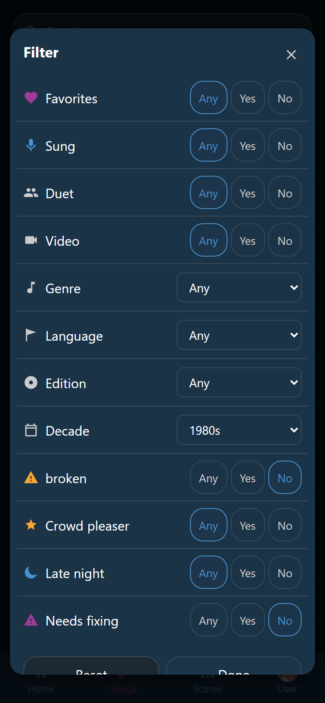

# Filter the list

**All**, **Favorites**, and **Sung** are shortcuts. The **Filter** panel is the
long way round, and it is where the tags live.

{ width="320" loading=lazy }
/// caption
**Video** is on **Yes** and **Decade** shows 1980s, so only the 80s songs with a video are left behind the panel.
///

## Set a filter

1. Open the **Songs** tab and tap :wingman-filter: **Filter**.
2. Tap the chips you care about. The list behind the panel follows every tap,
   the song count included.
3. Tap **Done** to close the panel.

**Reset** puts every chip back to where it started. That is not the same as
putting everything on **Any**. A tag set to hide its songs starts on **No**, and
**Reset** puts it back there.

## What the chips are

The panel has one chip per thing the list can be filtered on. The first group
holds the built-in chips, always in this order:

1. **Favorites** and **Sung**, the two marks.
2. **Duet** and **Video**, which the song file answers.
3. **Genre**, **Language**, **Edition**, and **Decade**.

Under a line, the second group holds every tag you are allowed to see.

**Favorites** and **Sung** are yours alone, so they only appear once you are
logged in. **Duet**, **Video**, and the four after them are the built-in
facets, and the party decides which of them the panel offers at all. A facet you read about here may
be switched off. See [Tags](../tags/index.md).

## Yes, no, or any

Most chips have three states. Tap a chip to move it on to the next one: **Any**,
then **Yes**, then **No**, then **Any** again. The line at the top of the panel
says the same: tap once for only these songs, twice to leave them out.

| State | What the chip looks like | What the list keeps |
|---|---|---|
| **Any** | Plain, the way it opened | Everything. That chip is not filtering |
| **Yes** | Filled in blue | Only the songs that have it |
| **No** | No fill, the name struck through, and :wingman-eye-off: in place of its glyph | Only the songs that do not |

A tag set to hide its songs opens on **No**. One tap puts it on **Any**, and its
songs come back.

Chips add up. Every chip that is not on **Any** narrows the list further.

!!! example "Rock duets only"
    Set the **Genre** chip to *Rock* and tap **Duet** once, to **Yes**. The list
    keeps the songs that are both, and the chip reads **Filter · 2**.

## Genre, language, edition, and decade

Those four chips have more than three answers, so a tap opens a list instead.
The first entry is the facet's own name, and it means **Any**. Then come the
values your own library holds: the genres actually on the shelf, the decades in
order.

Pick one and the list keeps the songs with that value. The chip turns blue and
shows the value in place of its name. A song whose file names no genre matches
**Any** alone, and the same goes for a song with no year. A file that writes the
word `None` where the genre goes is saying it has none, so those songs match
**Any** alone too. *None* is never offered as a genre.

These four come out of the song files, so they are the same for everybody in the
room, account or not.

## The count on the chip

While something is filtering, :wingman-filter: **Filter** is the pressed chip
and reads **Filter · 2**. The number is how many chips in the panel are off
**Any**. A facet counts like a tag, and so does a tag that was already hiding
songs before you opened the panel.

Tapping **All**, **Favorites**, or **Sung** throws the whole filter away.
**Recent** does not. It lists the songs of the party going on now, the last one
sung first, and the filter keeps working inside it.
