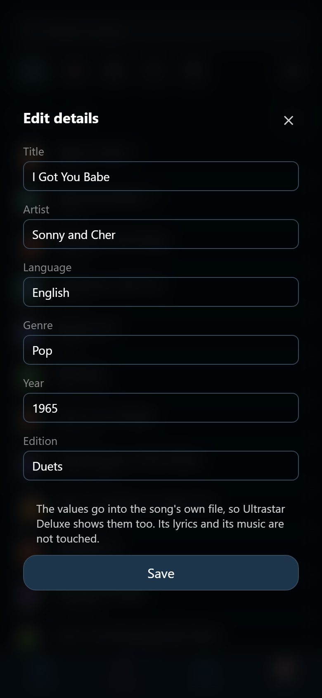

# Fix or delete a song

Downloaded songs arrive with whatever the person who built them typed. That can
be a misspelled artist, no year, a genre in the wrong language, or a title with
a website's name stuck to it. Both repairs live behind the same button of the
song's own view, :wingman-pencil: **Edit details** at the end of the line under
the artist. See [Open a song](song.md).

## Fix a song's details

1. Open the song and tap :wingman-pencil: **Edit details**.
2. Correct **Title**, **Artist**, **Language**, **Genre**, **Year**, or
   **Edition**.
3. Tap **Save**.

{ width="320" loading=lazy }
/// caption
Six values, and Wingman writes them into the song's own file.
///

**Title** and **Artist** have to say something. The other four may be left
empty, which means the song has no year (or no genre, and so on). The filter
then treats it as a song with nothing to match. **Year** takes a number from 0
to 9999. Typing the word `None` into **Language**, **Genre**, or **Edition**
empties it as well: song files written by USDB use that word for "nothing
here", so Wingman reads it that way too.

What Wingman writes is the song's own file, not only its own copy of the row.
Ultrastar Deluxe shows the corrected title too, and the next library scan agrees
with what you typed instead of putting the old value back.

Only those few lines of the file change. The lyrics, the timing, the audio, the
video, and the cover stay exactly as they were. So does everything the party did
with the song: its tags, favorites, wishes, playlist entries, comments, and
scores.

Fixing details is a helper's job. Trusted and Admin hold the right by default.
See [Groups and permissions](../people/groups.md).

### When Wingman refuses to save

Five answers are worth knowing. In every one of them nothing was written.

- **The file changed while the editor was open.** Somebody downloaded the song
  again, or edited its file by hand. Saving would put your older values over
  theirs. Close the song, open it again, and you see what the file says now.
- **The file is still open.** Ultrastar Deluxe is holding the song, usually
  because it is the one on the TV. Close Ultrastar Deluxe, or wait for the song
  to end, then save again.
- **The file cannot spell a value.** A file written in an old encoding has no
  way to write some letters. Wingman says so rather than rewriting the whole
  file into another alphabet.
- **The file's encoding cannot be reproduced.** Writing it back would garble the
  lyrics, so Wingman leaves it alone. Convert the file to UTF-8 outside Wingman,
  or download the song again.
- **The file is gone.** Rescan the library to find out what happened to the
  song.

## Delete a song

A song nobody wants to sing again can leave the library for good: a broken
file, a duplicate, a download that went wrong.

1. Open the song and tap :wingman-pencil: **Edit details**.
2. Tap **Delete song** at the foot of the form.
3. Read what the confirmation names, then tap **Delete**.

Only Admin holds the right by default, and the host can hand it to Trusted as
well. See [Groups and permissions](../people/groups.md).

Deleting a song and correcting its details are the same errand, so they share
one form. If you may delete a song but not correct it, the fields are
there to read. **Delete song** is then the only thing you can tap.

!!! warning
    Deleting a song removes its whole folder from the disk: the lyrics file, the
    audio, the video, and the cover. There is no undo and there is no bin.

Taking the song out of the list alone would not help. The next start would find
the folder and read the song straight back in.

### What survives a deletion

Everything the party *did* with the song stays.

- The **scores** and the parties they were sung at. A score of a deleted song
  still counts toward a singer's record. It has no song left to name.
- The **comments**, the **tags**, the **favorites** that pointed at it, and its
  place in a **playlist**. None of them shows up anywhere while the song is
  gone. Download the very same song again and it comes back under the same name
  and finds all of it again.

The **wishes** are the exception, and they go. A wish means "somebody should
sing this tonight", and after the file is gone nobody can.

### When Wingman refuses to delete

A deletion can be stopped, always with a sentence saying why. In every case
nothing at all is deleted.

- The song is **playing right now**. Stop it first.
- Ultrastar Deluxe still has the song's files open. Close it and try again.
- The song's folder is, or holds, your songs folder itself. Deleting it would
  take the whole library with it, so Wingman refuses. Fix the folder first.
