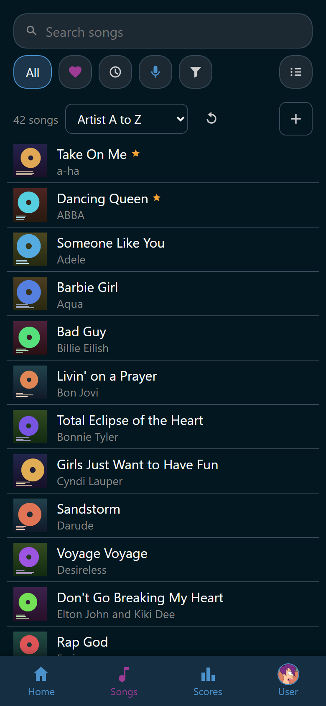

# The song list

The **Songs** tab holds every song Wingman found in your song folders. It is
where you search, narrow the list down, and open the song you want to sing.

{ width="320" loading=lazy }
/// caption
The chips under the search box switch what the list holds.
///

## Find a song

The list is ordered by artist, then by title.

1. Type in **Search songs**. It matches the title and the artist while you
   type, and a song id works too.
2. Tap :wingman-close: **Clear search** to empty the box again.
3. Tap a row to open the song.

The line above the list counts the songs the current filter holds. Two buttons
sit beside that count, for the roles that may use them.

- :wingman-refresh: **Rescan** reads the song folders again, for songs you
  copied in by hand. A finished download needs no rescan.
- :wingman-plus: **Add songs** opens the online sources Wingman can download
  from. See [Download songs](download.md).

## The chips under the search box

The chips switch the list. The chip you are standing on spells its name out, and
the others shrink to their glyph, so the row keeps fitting a phone. **All** has
no glyph, so it keeps its name either way.

| Chip | What the list holds |
|---|---|
| **All** | Every song |
| :wingman-heart: **Favorites** | The songs you marked for yourself |
| :wingman-clock: **Recent** | The songs of the party going on now |
| :wingman-mic: **Sung** | The songs you got a score on |
| :wingman-filter: **Filter** | Everything the other chips cannot say |

**Favorites** and **Sung** need an account, so a guest phone gets neither.
**Sung** also needs a player behind that account. **Recent** appears once
somebody has sung something tonight.

**Filter** opens a panel instead of switching the list. It counts what it is
narrowing on, so a pressed **Filter · 2** means two chips in the panel are set. See
[Filter the list](filter.md).

:wingman-list: **Playlists** sits at the end of the row and leaves the filters
behind. See [Playlists](playlists.md).

## The marks next to a title

A row can carry small glyphs after the song's title. They are marks, not
buttons: tapping one opens the song, the same as tapping anywhere else on the
row. The song's own view is where each state is changed.

- :wingman-mic: You sang this song before, in this party or in any party
  Wingman ever recorded.
- :wingman-heart: The song is one of your favorites.
- :wingman-users: The file is written as a duet.
- :wingman-video: The song has a video.
- One glyph per tag the song wears that the party put on the rows.

The duet and video marks are off until the party turns them on. Most libraries
hold so many of each that the glyphs would say nothing. The colors and the
on-off switches are the party's, and so is which tags reach a row. See
[Tags](../tags/index.md).

Genre, language, edition, and year are never marks. They live in the song's own
**Details** and in the filter.

## What has already been sung

**Recent** lists the songs of the party going on now, the one played last at
the top, with the time it started beside it. A song sung twice appears once, at
the later time.

The list holds every song that was *started*. A song somebody stopped after one
verse is in it even though Ultrastar Deluxe never scored it. The search box
works inside the chip, which helps when the room wants the same song again.

The **Sung** chip is a different question: it holds the songs you got a score
on. A song nobody scored belongs to no player in particular, so it stays out.

## Songs you do not see

Some songs are deliberately kept out of the list.

- A tag can be set to hide its songs. They are out of every chip and out of the
  reel's **All songs** until you put that tag's chip on **Any** or **Yes** in
  **Filter**. They are still there. A playlist that holds one still shows it,
  and a wished one can still win the reel.
- A tag can also take seeing its songs away from a role. Those songs do not
  exist for that person at all. They are not in the list, not in the search, not
  in the reel, and not on a playlist or the wishlist either.

If a filter comes up empty because of the first kind, the page says so instead
of claiming you have no favorites. See [Tags](../tags/index.md) for the whole picture.

## The rest of this section

- [Filter the list](filter.md): the Filter panel, the facets, and tags.
- [Open a song](song.md): the song view, best scores, and comments.
- [Playlists](playlists.md): make one, fill it, share it, and spin it.
- [Download songs](download.md): get new songs from USDB.
- [Tags](../tags/index.md): label songs, and decide who may see which.
- [Fix or delete a song](fix-or-delete.md): correct the details, or take a song
  off the disk.
