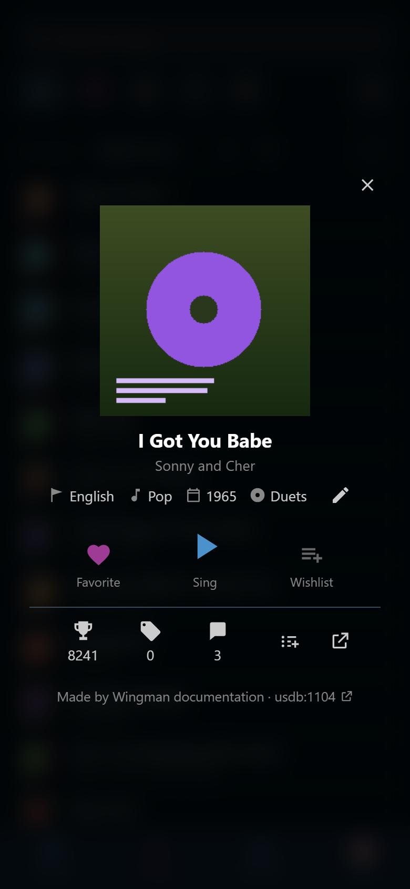
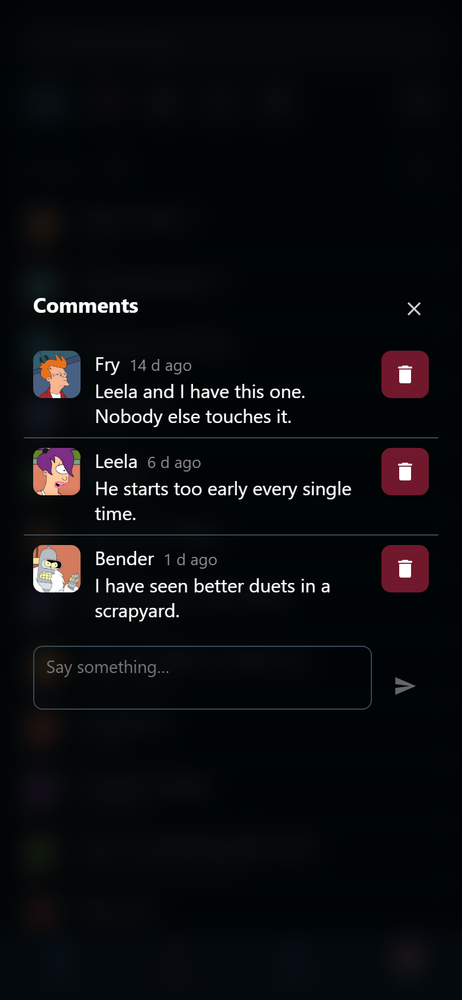

# Open a song

Tapping a song anywhere in Wingman opens the same view. That works from the song
list, from the wishlist, from a playlist, from the reel, and from the cover of
the song playing right now.

At the top stand the cover, the title, and the artist, with what the song says
about itself on one line under them. Then comes an audio preview, so you can
hear which version this is before the room does. A song whose folder holds no
audio has no player.

{ width="320" loading=lazy }
/// caption
The glyphs with numbers count the best score, the tags, and the comments.
///

## What the song says

The line under the artist holds up to four facts, each after its own glyph:

| Glyph | Fact |
|---|---|
| :wingman-flag: | The language |
| :wingman-music: | The genre |
| :wingman-calendar: | The year |
| :wingman-disc: | The edition |

A fact the file does not name is left out. A song that names none of them
shows no facts. A very long genre or edition is cut short.

For the party's helpers, the line ends in :wingman-pencil: **Edit details**. It
corrects what the song says about itself, and **Delete song** at the foot of
that form takes the song out of the library. See
[Fix or delete a song](fix-or-delete.md).

The small line at the very foot of the view says who built the karaoke file and
where the song came from, such as "Made by DrFrank · usdb:24435". For a song
from USDB the line ends in :wingman-external-link:, and tapping it opens the
song's page on USDB in a new tab.

## The three buttons

Each of the three carries its word under its glyph.

| Button | What it does |
|---|---|
| :wingman-heart: **Favorite** | Marks the song for you alone |
| :wingman-play: **Sing** | Opens the player selection |
| :wingman-playlist-plus: **Wishlist** | Puts the song on tonight's wishlist |

**Favorite** needs an account, because a favorite belongs to one. Nobody else
can see your favorites, and there is no right for the host to grant. Tap the
heart again to take the song back off. Your favorites have their own chip on
[the song list](index.md).

Once the song is on the list, the glyph over **Wishlist** turns into
:wingman-playlist-check:. Tap it again to take your wish back. See
[Wish for a song](../party/wishlist.md).

:wingman-play: **Sing** is the way into the evening. See
[Sing a song](../party/sing.md).

## The action bar

One row sits under the three buttons. It starts with three glyphs, each with a
number under it, and each opens what it counts.

- :wingman-trophy: **Best scores** is the highest score anybody ever got on the
  song. It appears once somebody has sung it. It also needs the right to read
  past parties, which an account holds and a guest phone does not.
- :wingman-tag: **Tags** is how many tags the song wears.
- :wingman-comment: **Comments** is how many comments people left.

**Tags** and **Comments** stand at **0** as well. Putting the first tag on a
song and being the first to say something are exactly what they lead to.

Two plain buttons end the row:

- :wingman-list-plus: **Add to playlist** lists the playlists you may edit. Tap
  one to add the song, tap it again to take it out. It needs an account. See
  [Playlists](playlists.md).
- :wingman-external-link: **Open in a streaming service** lists five music
  services. See [Open in a streaming service](#open-in-a-streaming-service).

You only see the buttons your role may use.

## Best scores

**Best scores** opens the song's whole record. It is headed by the same figures
the **User** tab and the **Scores** tab print: :wingman-hash: **Sings**,
:wingman-arrow-up: **Best**, :wingman-average: **Average**, and
:wingman-arrow-down: **Worst**. There is no **Songs** figure here, because every
score in the view is this one song. **Best** and **Worst** name the singer who
holds them.

Under the figures stands the ranking, best first, up to ten singers deep. From
four scores on, a picture of every score the song ever got stands between the
two, with the median of all of them written above it.

## Open in a streaming service

**Open in a streaming service** lists **Spotify**, **Apple Music**,
**YouTube Music**, **Tidal**, and **Deezer**, each after its own mark. Tap one and
the service opens in a new tab, searching for the artist and the title.

It is a search, so a song the service spells a little differently still turns
up. Wingman leaves out the notes a karaoke file adds to a title, such as "[DUET]".
Everybody gets this button, a guest phone included. Listening somewhere else
takes no permission in Wingman.

## Tags

**Tags** opens every tag you may see. A tag the song wears is drawn in its own
color, and a tag it does not wear is gray. Tap a row to put the tag on the song
or take it off.

A tag you may see but not set carries :wingman-lock: and does nothing when
tapped. Who may set which tag is decided per tag. See [Tags](../tags/index.md).

## Comments

**Comments** opens what everybody said about the song, oldest first: who said
it, how long ago, and the text underneath.

{ width="320" loading=lazy }
/// caption
Every comment carries the picture and the name of whoever wrote it.
///

Reading is open to everybody. A guest phone that can see the song list can read
the comments too. Knowing that a song is in the wrong key is worth more shared
than hidden.

Writing takes an account, because a comment carries your name and your picture.
Log in and a box appears at the foot of the list. Type, then tap
:wingman-send: **Send**. Everybody in the room sees it at once. A comment holds
up to 1000 characters, and there is no editing.

!!! tip
    ++enter++ starts a new line in the box. ++ctrl+enter++ sends, and
    ++cmd+enter++ does the same on a Mac.

Tap :wingman-trash: **Delete** on your own comment to take it back. Wingman asks
first. Nobody has to grant you that and nobody can take it away. Deleting
somebody else's comment is a moderator's right, which Trusted and Admin hold by
default. See [Roles and permissions](../people/roles.md).

!!! note
    The host screen reads comments and writes none. It is an administrator, but
    it is nobody in particular and has no name to sign a comment with. Comment
    from your own phone instead.
