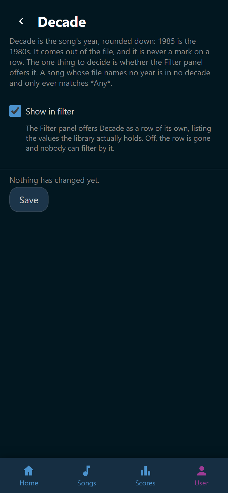

# Built-in marks and facets

Eight rows stand under **Built-in** at the foot of **User** > **Tags**. They
look like tags and they are not. Nobody puts them on a song. Two of them say
something about you. The other six are what the song file already says about
itself.

| Built-in | What it is | What you can set |
|---|---|---|
| :wingman-heart: **Favorites** | The songs you marked as favorites | Color, Show in song list |
| :wingman-mic: **Sung** | The songs you have a score on | Color, Show in song list |
| :wingman-users: **Duet** | The file is written for two singers | Color, Show in song list, Show in filter |
| :wingman-video: **Video** | The song folder holds a video | Color, Show in song list, Show in filter |
| :wingman-music: **Genre** | The genre line of the song file | Show in filter |
| :wingman-flag: **Language** | The language line of the song file | Show in filter |
| :wingman-disc: **Edition** | The edition line, such as a SingStar set | Show in filter |
| :wingman-calendar: **Decade** | The year, rounded down. 1985 is the **1980s** | Show in filter |

## The options

**Color** is one of the four a tag may wear. The heart starts pink and the
microphone blue, and the two boolean facets start neutral. The color follows the
mark everywhere it is drawn: the song rows, the chips over the list, and the
**Filter** panel. The heart and microphone buttons in a song's own view keep
their own colors, because those are switches and not marks.

**Show in song list** decides whether the mark goes on the song rows at all.
Favorites and Sung start on. Duet and Video start off, because half a library is
one or the other and a mark most songs wear says nothing at a glance.

**Show in filter** decides whether the **Filter** panel offers the row. Turn it
off and nobody can filter by that fact. The six facets start on. See
[Filter the list](../songs/filter.md).

## Why they are not tags

A built-in has no name to change, no icon to pick, no songs to hide, nobody to
grant it to, and no delete. There is nothing to name, because the app calls it
what it is. There is nobody to grant it to, because everybody sees the same
facts.

The two marks have no song count either. That number would be different for
every reader. A facet has no count for the same reason: it would be one number
per value.

Genre, language, edition, and decade have no color, because they are never a
mark on a row. A song's own **Details** is where the values are read.

The values themselves come out of the song files, so the **Filter** panel offers
exactly what your library holds. Add a Schlager song and *Schlager* joins the
genre list on its own.

## Change one

Tap a built-in row on **User** > **Tags**. The editor holds only the options its
kind has, over a line saying why it holds no more.

{ width="320" loading=lazy }
/// caption
**Decade** has one option, because there is nothing else about it to set.
///

A change applies to everybody at once and takes the right to manage tags, the
same as a tag. See [Tags](index.md).

!!! note
    **Recent** is not on this page. It is not a mark. It is a way of ordering
    the song list by what was sung tonight, and there is nothing about it to
    color.
