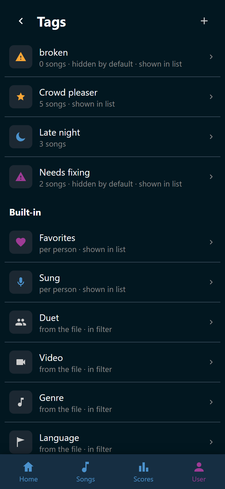
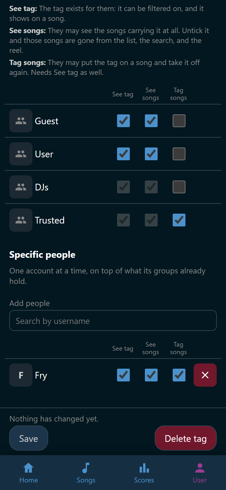

# Tags

A tag is a label the whole party shares. A wish or a favorite belongs to one
person. A tag belongs to the song. Put **broken** on the file that never plays,
or **christmas** on the ones nobody wants in July.

The point of a tag is that you decide, per tag, who may know it exists and who
may see the songs under it.

Making tags takes the right to manage tags, which Trusted and Admin hold by
default. Everybody else sees the result. See
[Groups and permissions](../people/groups.md).

## The tags page

**User** > **Tags** lists every tag. Under each name stands a line saying how
many songs carry it and which of its two options are on. Tap a row to open it.

{ width="320" loading=lazy }
/// caption
Each tag keeps its own glyph and color wherever Wingman draws it.
///

Under **Built-in** stand eight more rows. They look like tags and are not. See
[Built-in marks and facets](built-in.md).

Wingman starts with one real tag, **broken**, for a song that does not work.
Only Trusted and Admin may see it, so a song marked broken is invisible to
everybody else. It also hides its songs by default, so even a helper meets them
through the filter. It is an ordinary tag, so rename it, recolor it, or delete
it.

## Make a tag

1. Open **User** > **Tags** and tap :wingman-plus: **New tag**.
2. Type a **Name** of up to 32 characters.
3. Pick an **Icon**, or leave it on **No icon**.
4. Pick a **Color**: **Neutral**, **Blue**, **Pink**, or **Gold**.
5. Decide the two options below the color.
6. Tick who the tag is for under **Permissions**.
7. Tap **Save**.

A new tag starts open. Everybody sees it and its songs, and Trusted accounts may
put it on a song. Change the ticks before you save when the tag is meant to be
private.

## The two options

**Show in song list** puts the tag's icon on every song carrying it, next to the
favorite heart. Leave it off for a tag half the library would end up with, or
the rows fill with glyphs.

**Hide songs by default** keeps those songs out of the song list and out of the
reel until somebody asks for them in the filter. It is a default and not a lock.
Everybody who may see the tag can bring the songs back. See
[Filter the list](../songs/filter.md).

## Who sees what

Every tag carries three separate rights, one row each in the editor.

| Right | What it means |
|---|---|
| **See tag** | The tag exists for that person. They can filter on it and see it on a song |
| **See songs** | They may see the songs carrying the tag at all |
| **Tag songs** | They may put the tag on a song and take it off again |

**See songs** is the one with teeth. Take it away and every song wearing that
tag disappears for that person. It goes out of the list, out of the search, out
of the reel, and off any playlist. That is how **broken** works.

**Tag songs** only works alongside **See tag**. Nobody sets a label they are not
allowed to know about.

Under **Permissions** every group is a row, Guest and User first, with the
three rights as its columns. Administrators have no row. They see every tag and
every song, so no combination of ticks hides anything from the host.

A group of your own adds to User. Where User holds a right on the tag, the
group's box is ticked and grayed out: every account holds that right already,
the group's members included. See [Groups and permissions](../people/groups.md).

**Specific people** under the groups gives one account more than its groups
hold. Type into **Add people** to search by username, then tick the rights for
that person.

{ width="320" loading=lazy }
/// caption
Fry may tag songs here, although no group of his may.
///

Two sentences may appear under the table while you tick. They are warnings, not
refusals, and Wingman saves either way:

- Somebody who may tag songs without seeing them would watch a song vanish the
  moment they tag it.
- Somebody who may see the tag but none of its songs gets a filter that is
  always empty.

!!! note
    Taking **See tag** away from yourself is safe. **User** > **Tags** lists
    every tag to everybody who may manage tags, so you can always tick it back
    on.

## Put a tag on a song

Tags are set up here and used on the song itself. Open a song, tap
:wingman-tag: **Tags**, and tap a row to put the tag on or take it off. A tag
you may see but not set carries :wingman-lock: and does nothing. See
[Open a song](../songs/song.md).

## Change or delete a tag

Tap a tag on **User** > **Tags** to open it again. Everything is editable, the
permissions included. **Save** and **Delete tag** sit in one row at the foot of
the screen, wherever you have scrolled to. When **Save** is off, the line above
it says why.

**Delete tag** asks first and names how many songs it comes off. It removes the
tag from every song carrying it and from everybody it was granted to. The songs
themselves stay in the library. Only the label goes.
